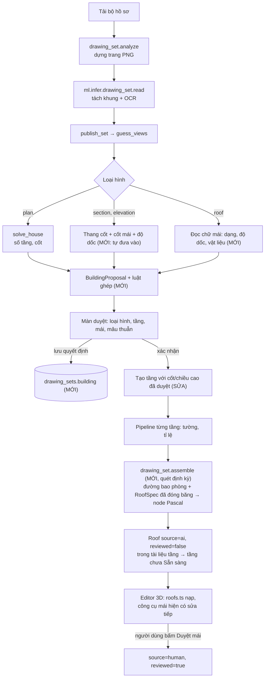

# Thiết kế: bộ hồ sơ bản vẽ → mô hình nhà nhiều tầng có mái

*Giai đoạn 1 (khảo sát + thiết kế), ngày 25/11/2026. Chưa sửa dòng mã nào. Nhánh khảo sát: AppBack `main` @ `5e08d45f`, AppFront `master` @ `f6fec400`.*

*Bản 2, cùng ngày: sửa sau một lượt soi độc lập của 5 subagent (kiến trúc BE, mái, giao diện, đo lường, khả năng triển khai). Danh sách câu hỏi họ nêu, câu trả lời và chỗ đã sửa ở §7.4.*

**Cách đọc nhãn bằng chứng**

- **✔** — người điều phối đã mở file và thấy đúng.
- **(SA)** — subagent báo, người điều phối chưa tự mở; coi là giả thuyết.
- **[ĐỀ XUẤT]** — con số hoặc quyết định do thiết kế này đặt ra, chưa đo.

**Thuật ngữ dùng trong tài liệu**

| Thuật ngữ | Nghĩa |
|---|---|
| Hình (view) | Một hình vẽ trên một trang: mặt bằng, mặt cắt, mặt đứng, mặt bằng mái… Một tờ có thể chứa nhiều hình. |
| Cốt (cao độ) | Độ cao so với mốc ±0.000, đơn vị mm trong DB. |
| Thang cốt | Tập các cốt đọc được trên mặt cắt/mặt đứng, dùng để suy cốt từng tầng. |
| Diềm mái (eave) | Mép thấp của mái dốc; **đỉnh mái (ridge)** là đường cao nhất. |
| Hip / valley | Đường bờ (hai mặt mái gặp nhau lồi) / khe mái (gặp nhau lõm). |
| Node Pascal | Phần tử cảnh của trình sửa 3D (vendor `AppFront/vendor/pascal`). Mái là một node `roof` chứa các node `roof-segment`. |
| Lỗi im lặng | Kết quả sai mà hệ thống vẫn báo "Sẵn sàng". Đích là 0. |
| Expand/contract | Kiểu migration hai bước: bước này chỉ thêm (expand), bước xoá/đổi để phát hành sau (contract). |

---

## 0. Tóm tắt

1. **Ống nối bộ hồ sơ đã có đủ** (tải lên → tách hình → phân loại → duyệt → xác nhận → tạo tầng), nhưng ba mắt xích then chốt chưa nối: mặt cắt/mặt đứng không đóng góp gì trong luồng bộ hồ sơ, xác nhận bỏ qua cốt máy đề xuất (dùng 3000 mm cố định), và mái không được trích hay dựng ở bất kỳ đâu.
2. **Mái (ADR-01):** thêm mô hình mái ngữ nghĩa `RoofSpec` ở bước đề xuất/duyệt; BE chuyển nó **một lần** thành node Pascal sau khi pipeline tầng chạy xong. Từ đó node Pascal là nguồn sự thật duy nhất, người dùng sửa bằng công cụ mái hiện có. Kiểu `Roof` trên dây **không đổi**.
3. **Đường bao mái đợt đầu lấy từ tường của tầng nó che**, không lấy từ nét vẽ trên mặt bằng mái. Mặt bằng mái, mặt cắt, mặt đứng cấp *thuộc tính* (dạng, độ dốc, cao độ, vật liệu). Lý do: hình mặt bằng mái không đi qua pipeline nên không có tỉ lệ mm và không căn được vào toạ độ tầng.
4. **Không cần straight skeleton.** Mặt mái của Pascal là hình chữ nhật; mái chữ L/T ghép từ nhiều chữ nhật chồng nhau, Pascal tự giải giao tuyến. Thư viện skeleton tốt nhất (CGAL, bpypolyskel) là GPL.
5. **Một migration** (thêm cột `drawing_sets.building`), **13 lát** cho đợt đầu, 4 lát để đợt sau.
6. **Phải đo trước khi sửa:** số hiện có (75 % tách hình, 2/10 bộ đúng tầng) đo trên 10 tờ đã bị chỉnh luật theo. Dữ liệu thật có 108 bộ có ảnh nhưng chỉ **51 bộ có đáp án**; đáp án mái mới có ở mức thô cho 30 bộ (bằng/dốc/hỗn hợp, cốt chân và đỉnh), **chưa có** độ dốc, dạng mái chi tiết hay đường bao mái.
7. **Mọi mái máy dựng đều chặn "Sẵn sàng"** cho tới khi người dùng bấm duyệt. Lý do: hướng mái luôn là đoán, và mái chưa từng được đo.



---

## 1. Hiện trạng theo mảng

### 1.A Phân loại hình

| Mức | Nội dung | Bằng chứng |
|---|---|---|
| CHẠY | Đường đi đủ: `create_set` → `complete_set` → `drawing_set.analyze` → `ml.infer.drawing_set.read` → `publish_set` → `guess_views` → bảng `drawing_set_views`. | `apps/api/drawing_sets/set_upload.py:98,343`, `jobs.py:185`, `apps/ml/drawing_set_read/tasks.py`, `analysis.py:129` (SA) |
| CHẠY | 7 loại hình trên dây: plan, section, elevation, roof, site, detail, other. | `apps/api/drawing_sets/schemas.py:17` ✔, `packages/domain/drawing_set/set_analysis.py:43-52` ✔ |
| CHẠY | Phân loại theo tên hình (regex đã bỏ dấu, tiếng Việt + tiếng Anh), nội dung chỉ nâng/hạ độ tin. Hình khác mặt bằng mà độ tin < 0,8 thì hỏi `NOT_A_PLAN`; không chữ thì `NO_TEXT`. | `set_analysis.py:37,180-190` ✔, `titles.py:176-189`, `page_kind.py:29-38` (SA) |
| YẾU | Tách hình trên tờ ghép: tìm được 76/102 (75 %), kiểm chéo 65/84 (77 %). Đúng loại 52/76. | `changes/K-32a.md:111-119` ✔ |
| YẾU | Luồng bộ hồ sơ **không truyền hình học** vào bộ phân loại: chỉ còn chữ OCR. | `set_analysis.py:192` ✔ |
| YẾU | Hai bộ phân loại song song (`page_kind.classify_page` và `titles.view_kind`) có thể bất đồng. | `titles.py:844` (SA) |
| YẾU | OCR chỉ có model nhận dạng tiếng Trung/Anh của wheel, không có dấu tiếng Việt (NO-546, NO-564). Luật so khớp đã bỏ dấu nên vẫn nhận được tiêu đề; chuỗi hiển thị thì sai. | `K-32a.md:127-128` ✔ |
| THIẾU | Ngôn ngữ ngoài Việt/Anh; feet-inch; đọc lớp chữ của PDF vector (không có lời gọi `get_textpage` nào trong `apps/`, `packages/`) ✔; ký hiệu mặt cắt và mũi tên hướng nhìn; xử lý riêng cho hình `roof`. | grep ✔ |

### 1.B Mặt bằng tầng + căn chồng

| Mức | Nội dung | Bằng chứng |
|---|---|---|
| CHẠY | Đề xuất số tầng, cốt, chiều cao cho cả nhà, kèm độ tin và nguồn. | `proposal.py:95-115` ✔, `heights.py:57-70` ✔ |
| CHẠY | 3D xếp chồng tầng theo cốt và chiều cao, kể cả lửng/tum. | `AppFront/src/lib/pascal/toPascal.ts:396-408` ✔ |
| YẾU | Xác nhận tạo tầng mới với cốt = đỉnh tầng cao nhất hiện có và **chiều cao cố định 3000 mm**; không dùng đề xuất của máy. | `apps/api/drawing_sets/confirm.py:54,226-245` ✔ |
| YẾU | Trong luồng bộ hồ sơ, `guess_views` chỉ đưa hình `plan` vào `solve_house` và **không truyền mặt cắt**. | `set_analysis.py:227-230` ✔ |
| YẾU | Căn XY giữa các tầng chỉ là phép biến đổi hiển thị ở FE (theo trục chung hoặc tâm khung bao tường), không lưu, người dùng không chỉnh được. | `AppFront/src/lib/pascal/floorAlignment.ts:12-68` ✔ |
| THIẾU | `stack_pair`, `register_h`, `register_v` có test nhưng không được gọi từ `apps/api` hay `apps/worker`. Bảng tầng không có cột gốc toạ độ. | grep ✔, `packages/db/models/floors.py` ✔ |
| THIẾU | Bộ chuyển từ kết quả pipeline sang `FloorObservation` (NO-522), tác vụ ráp nhà (NO-527, NO-544), bộ dò thang (NO-528). | `changes/K-32a.md`, `K-32d.md` (SA) |

### 1.C Mái

| Mức | Nội dung | Bằng chứng |
|---|---|---|
| CHẠY | Vẽ tay → lưu → đọc lại. `Roof` = `{id, levelId, nodes[1..33], ≤ 64 KB}` + trường duyệt chung (`confidence`, `source`, `reviewed`, `edited`). | `packages/domain/spatial/model.py:389-413` ✔, `AppFront/src/api/schemas/spatial.ts:441-455` ✔ |
| CHẠY | BE không đọc bên trong `nodes`; lưu trong jsonb tài liệu tầng, không cột riêng. | `model.py:399` ✔ |
| CHẠY | Pipeline không sinh mái và luôn giữ mái hiện có. | `packages/domain/rules_ai/merge.py:337-338` ✔ |
| CHẠY | Cầu nối FE gắn mái dưới node tầng theo `levelId`, chép `{confidence, source, reviewed}` vào `metadata.appfront`; có test "nạp rồi đọc ngược ra 0 lệnh". | `AppFront/src/lib/pascal/roofs.ts:66-91` ✔, `toPascal.ts:2184-2203` ✔ |
| CHẠY | Mặt mái Pascal (`roof-segment`) là **hình chữ nhật**: `position`, `rotation`, `width`, `depth`, `roofType` (hip, gable, shed, gambrel, dutch, mansard, flat, conical), `pitch` (độ, 0–85), `wallHeight`, `overhang`. Chiều cao đỉnh không lưu, suy từ `pitch` + kích thước. | `AppFront/vendor/pascal/packages/core/src/schema/nodes/roof-segment.ts:7-16,92-235,579-606` ✔ |
| CHẠY | Mái nhiều khối: các mặt mái chồng nhau, vùng chồng thuộc về mặt có diện tích lớn hơn; giao tuyến do CSG lúc render giải. | `core/src/lib/roof-overlap.ts:36-57` ✔, `viewer/src/systems/roof/roof-system.tsx` (SA) |
| YẾU | Phụ kiện con của mặt mái (ống máng, dormer, ống khói, cửa mái) **không lưu về BE**: vẽ xong, lưu, nạp lại là mất. | `roofs.ts:11-12` ✔ (chú thích) |
| YẾU | Hiệu chỉnh tỉ lệ co giãn tường nhưng **giữ nguyên mái** → mái lệch khỏi tường. Pipeline chạy lại cũng giữ mọi mái, kể cả mái máy dựng chưa duyệt. Mái không có dấu xoá ("bia mộ" chỉ có cho tường và phòng). | `packages/domain/scale/rescale.py:136` ✔, `merge.py:337-338` ✔, `merge.py:33-36` (SA) |
| YẾU | Lúc nạp cảnh, Pascal tự sửa node mái ở hai chỗ: `pitch ≤ 0` → 40, và cao độ của mái kiểu `walls`. | `vendor/pascal/packages/core/src/store/use-scene.ts:798-811` ✔, `core/src/systems/roof/roof-elevation-system.tsx:45-56` ✔ |
| THIẾU | Sinh mái từ bản vẽ; hình học mái ở BE; trích gì đó từ hình `roof` (bị xếp vào `_NOT_PLAN_KINDS`); parapet (Pascal không có). | `proposal.py:71` ✔ |
| THIẾU | Tum/áp mái/sân thượng chỉ được đoán như một tầng cao hơn tầng cao nhất, độ tin 0,7. | `storeys.py:740-741` (SA) |

**Ba cái bẫy cho người làm tiếp:**

- `sample_roof` ở BE ghi `"pitch": 0.5236` (radian) trong khi schema Pascal dùng **độ** (`packages/domain/spatial/samples.py:280` ✔). Đó là dữ liệu thử khứ hồi, **không dùng làm mẫu sinh mái**.
- Fixture của `roofs.test.ts` còn trường cũ `roofHeight` mà schema đã bỏ (`AppFront/src/pascal-page/__tests__/roofs.test.ts:51` ✔).
- `roof-contract.md` được 15 file nhắc tên nhưng **không tồn tại** trong cây làm việc lẫn lịch sử git ở `docs/contracts/`, `docs/pascal/` ✔. Hợp đồng mái thực tế là chú thích trong `roofs.ts` và `model.py`.

### 1.D Mặt cắt + mặt đứng

| Mức | Nội dung | Bằng chứng |
|---|---|---|
| CHẠY | Đọc cốt dạng mét (`+3.600`, `±0.000`) và mm có dấu; khớp đường thẳng để loại cốt đọc nhầm; ghép với mặt bằng ra cốt + chiều cao tầng. | `levels.py:91-192`, `sections.py:153-175` (SA) |
| YẾU | Chỉ hình **người dùng tự đánh dấu** là mặt cắt mới vào thang cốt; và chỉ ở luồng "đề xuất cho cả nhà" (N52), không ở luồng bộ hồ sơ. | `apps/api/drawing_sets/service.py:225-229` ✔ |
| YẾU | Chuỗi cốt **cố ý cắt bỏ bậc trên cùng** chỉ có ở mặt cắt vì coi là mái/đỉnh/tường chắn mái: thông tin mái đang bị vứt. | `chain.py:258-260` ✔ |
| YẾU | `LevelSource` có hai định nghĩa: miền (5 giá trị) và dây (thêm `dims`). `dims` chưa có mã nào gán (SA). Nguồn cốt không lưu DB (SA). | `heights.py:68` ✔, `apps/api/drawing_sets/schemas.py:19` ✔ |
| THIẾU | Cốt diềm/đỉnh mái; độ dốc; số tầng từ mặt cắt; dạng mái từ mặt đứng; liên kết ký hiệu A-A trên mặt bằng với hình mặt cắt; feet-inch; từ khoá `FFL`, `T.O. PLATE`, `EL.`. | grep ✔ (trong `packages/domain/drawing_set`) |

### 1.E Hợp nhất + luật ghép

| Mức | Nội dung | Bằng chứng |
|---|---|---|
| CHẠY | Mẫu "giá trị + độ tin + nguồn" và câu hỏi theo mã (`STOREY_CONFLICT`, `LEVEL_MISSING`, `HEIGHT_ASSUMED`…); bất đồng thì chặn độ tin ở 0,65. | `proposal.py:60-74,95-115` ✔, `schemas.py:20-28` ✔ |
| CHẠY | Luật hiến chương: đầu ra AI luôn `source:'ai', reviewed:false, edited:false`; hàm trộn không sửa/xoá mục đã duyệt, do người vẽ, hoặc đã sửa. | BE-00 §9 (đọc từ lịch sử git, xem §6 câu 1) ✔ |
| CHẠY | "Sẵn sàng" tính lúc đọc theo từng tầng; tầng chỉ "đã duyệt" khi mọi thực thể (kể cả mái) đã duyệt. | `apps/api/spatial_read/readiness.py:1-14` ✔, `assemble.py:75-84` ✔ |
| THIẾU | Mô hình "công trình" (tầng + mái + liên kết hình nguồn); bảng luật ghép; cách hiện mâu thuẫn cho người dùng chọn giữa các nguồn; chỗ lưu quyết định cấp bộ (`drawing_sets` không có cột JSONB nào). | `packages/db/models/drawing_sets.py:47-88` ✔ |

### 1.F Giao diện

| Mức | Nội dung | Bằng chứng |
|---|---|---|
| CHẠY | Màn bộ hồ sơ đủ luồng (chọn tệp, trạng thái, duyệt, xác nhận), dùng client thật. Người duyệt sửa loại hình, đích tầng, bỏ/dùng hình. | `AppFront/src/screens/upload/DrawingSetReview/*`, `src/api/drawingSetClient.ts:180` (SA) |
| CHẠY | Bảng "Đề xuất của máy cho cả nhà" có cốt/chiều cao/nguồn và nút "Nhận" từng ô — nhưng nằm ở màn Quản lý tầng, không ở màn bộ hồ sơ. | `src/screens/qc/FloorManager/FloorProposalPanel.tsx` (SA) |
| YẾU | Loại `roof` có trong danh sách chọn nhưng không có xử lý riêng; mâu thuẫn chỉ là mã câu hỏi dạng chữ. Không có e2e cho luồng duyệt + xác nhận. | `DrawingSetViewCard.tsx:130-195` (SA) |
| THIẾU | Ô cao độ/chiều cao/nguồn ở bước duyệt bộ; duyệt mái; chọn giữa các nguồn mâu thuẫn; mái tự sinh. | (SA) |
| THIẾU | Hành động "duyệt" cho thực thể trong 3D: không nơi nào ở `src/pascal-page` đặt `reviewed: true`; thẻ tin cậy chỉ có cho đồ vật. | `src/pascal-page/ItemTrustCard.tsx:58` ✔, grep ✔ |

---

## 2. Thiết kế từng mảng

Nguyên tắc chung: **mở rộng cái đang có, thay đổi nhỏ nhất mà đủ**. Mỗi mục ghi rõ cái bị cắt khỏi đợt đầu.

### 2.A Phân loại

1. **Đo trước (lát NHA-00).** Chấm phân loại, tách hình, số tầng, cốt trên 51 bộ có đáp án (§2.G). Mọi thay đổi luật sau đó phải có số trước/sau.
2. **Mở rộng từ khoá tên hình** ngay trong các regex sẵn có (`titles.py:176-189`), không dựng cơ chế mới:
   - Anh/Mỹ/Canada: `GROUND/MAIN/UPPER/LOWER FLOOR`, `LEVEL n`, `BASEMENT`, `ATTIC`, `ROOF PLAN`, `FRONT/REAR/LEFT/RIGHT/NORTH…ELEVATION`, `BUILDING/CROSS/LONGITUDINAL SECTION`.
   - Pháp (Canada): `PLAN`, `REZ-DE-CHAUSSÉE`, `ÉTAGE`, `SOUS-SOL`, `COUPE`, `ÉLÉVATION`, `FAÇADE`, `TOITURE`. Chỉ làm nếu bạn đồng ý ở §6 câu 6.
3. *(Đã cắt khỏi đợt đầu sau lượt soi.)* Tách mã hình `A-A`, `1-1`, `TRỤC 1-5` khỏi tên: đợt đầu chỉ để hiển thị, nhưng lại kéo theo đổi hợp đồng và sửa `set_analysis.py` trùng với lát khác. Làm cùng việc liên kết ký hiệu cắt ở đợt sau.
4. **Đọc lớp chữ PDF vector** thay cho OCR khi trang có chữ thật (pypdfium2 đã cài). Giải quyết luôn dấu tiếng Việt, ký tự `'` `"` của feet-inch và trị số độ dốc trên PDF vector. Đây là chức năng đề xuất thêm số 1 (§4), tách lát riêng.
5. **Khi không chắc:** giữ cơ chế hiện có (câu hỏi theo mã, người duyệt quyết). Thêm mã câu hỏi mới ở §2.E.

**Phạm vi ngôn ngữ đợt đầu, nói thẳng:** tiếng Việt và tiếng Anh; tiếng Pháp nếu bạn chọn ở §6. Chưa có ngôn ngữ nào khác (kể cả tiếng Trung, dù model OCR hiện tại nhận được chữ Trung). Bộ hồ sơ bằng ngôn ngữ khác vẫn chạy nhưng mọi hình sẽ rơi vào "không rõ loại" và người duyệt phải tự chọn.

**Cắt khỏi đợt đầu:** dò ký hiệu mặt cắt + mũi tên hướng nhìn trên mặt bằng (cần bộ dò ký hiệu, chưa có dữ liệu nhãn); hợp nhất hai bộ phân loại (ghi nợ, không chặn); model học cho phân loại (luật + chữ chưa được đo tới trần).

### 2.B Mặt bằng tầng + căn chồng

1. **Xác nhận dùng cốt và chiều cao đã duyệt — cho tầng mới.** `_create_floors` (`confirm.py:221`) đọc cốt/chiều cao từ `drawing_sets.building.confirmed` (§2.E). Không có thì giữ nguyên hành vi hiện tại (đỉnh tầng cao nhất + 3000 mm), nên luồng cũ không đổi. Hàm này chỉ chạy cho tầng mới và dòng mặt cắt (`confirm.py:227` ✔); hình nhắm vào **tầng có sẵn** không được ghi cốt — cách xử lý ở §2.E.
2. **Mặt cắt/mặt đứng tự vào thang cốt** trong luồng bộ hồ sơ: `guess_views` truyền các hình `section`/`elevation` có độ tin ≥ 0,8 vào `solve_house(sections=…)` — tham số đã có sẵn (`service.py:226-229`).
3. **Căn XY đợt đầu giữ nguyên ở FE.** Mái là con trực tiếp của node tầng và có `position` + `rotation`, nên đi theo phép biến đổi tầng sẵn có (`floorAlignment.ts:105-129` ✔).
4. **Tỉ lệ từng hình:** mỗi mặt bằng là một lượt tải riêng đi qua pipeline của tầng đó, nên đã có tỉ lệ riêng. Lưu ý cho mái: khi người dùng hiệu chỉnh tỉ lệ, tường được co giãn còn mái thì không (`packages/domain/scale/rescale.py:136` ✔). Tác vụ ráp nhà dựng lại mái máy dựng chưa sửa khi điều đó xảy ra (§2.E).
5. **Feet-inch ở mặt bằng tầng — chưa phủ.** Tài liệu này chỉ thêm parser feet-inch cho **cốt và độ dốc** (§2.D). Việc pipeline từng tầng đọc chuỗi kích thước `12'-6"` để ra tỉ lệ chưa được khảo sát; nếu nó không đọc được thì tầng rơi vào "chưa rõ tỉ lệ" và người dùng phải hiệu chỉnh tay. Phải kiểm ở lát NHA-00 bằng vài bộ feet-inch, và ghi rõ trong báo cáo cuối.

**Cắt khỏi đợt đầu (lát NHA-11, đợt sau):** lưu độ dời XY vào DB và nối `stack_pair` vào tác vụ ráp nhà. Việc này cần bộ chuyển pipeline → `FloorObservation` (NO-522), khoá theo dự án, cột mới và đổi hợp đồng FE–BE (NO-527). Hệ quả: các luật X-01…X-06 (thẳng hàng cột/tường/thang) và mái tầng thấp (sảnh/hiên/gara) phải chờ lát này.

### 2.C Mái

#### Câu 1 — Nguồn thông tin mái

| Nguồn | Cho được gì | Cách đọc ở đợt đầu | Độ tin [ĐỀ XUẤT] |
|---|---|---|---|
| Mặt bằng mái | Có mái hay không; trị số độ dốc (`i=30%`, `30°`, `6:12`); số nhóm mũi tên dốc (1 → shed, 2 → gable, 4 → hip); chữ vật liệu; chữ `SÊ NÔ`, `PARAPET`, `DRAIN`. | Chữ OCR/lớp chữ PDF + vị trí chữ so với tâm hình. **Không** đọc nét ridge/hip/valley. | Độ dốc ghi rõ: 0,8. Dạng suy từ số nhóm mũi tên: 0,6. |
| Mặt cắt | Cốt diềm, cốt đỉnh, đỉnh tường chắn mái (các bậc cốt nằm trên sàn cao nhất); **chiều cao tầng trên cùng**; độ dốc ghi chữ. | Lấy từ **thang cốt** (`_build_ladder`, `chain.py:83-86`) mọi bậc cao hơn sàn cao nhất, rồi phân vai bằng từ khoá (`ĐỈNH MÁI`, `RIDGE`, `T.O. PLATE`, `PARAPET`), sau đó mới đến vị trí. Không lấy từ các bậc bị gỡ ở `chain.py:258-260`: bậc cách bậc trước dưới 1,6 m — đúng trường hợp cốt diềm và đỉnh tường chắn mái — không bao giờ vào được đường đó (`_edge`, `chain.py:165-169` ✔). | Cốt có từ khoá: 0,8. Chỉ theo vị trí: 0,6. |
| Mặt đứng | Cốt đỉnh/diềm (như mặt cắt). Dạng mái nhìn ngoài (đầu hồi tam giác hay hình thang). | Đợt đầu chỉ lấy cốt. Dạng mái từ hình dáng: đợt sau. | Cốt: như mặt cắt. |
| Mặt bằng tầng | Đường bao phần nhà mà mái che — **nguồn đường bao chính**. Nhãn `SÂN THƯỢNG`, `TUM`, `TERRACE` → mái bằng. Nét đứt mép mái đua: đợt sau. | Hợp `Room.outline` của các phòng trong nhà (`model.py:335` ✔), nới ra nửa bề dày tường. Chi tiết và lý do ở Câu 5 bước 1. | Đường bao: theo độ tin của phòng. |
| Ghi chú vật liệu | Dải độ dốc hợp lý và dạng mái khả dĩ (`BTCT` → bằng; `NGÓI`, `TILE`, `SHINGLE` → dốc; `TÔN`, `METAL` → dốc thấp). | Từ khoá trên mọi hình của bộ. | Chỉ dùng để kiểm chéo và chọn mặc định: ≤ 0,4. |

Nét ridge/hip/valley, lỗ thoát nước, ô lấy sáng, ống khói, dormer: **không trích ở đợt đầu**. Lý do: cần hình học vector hoặc model học; không có tập dữ liệu mặt bằng mái công khai (nghiên cứu §7.3); và Pascal không lưu được phụ kiện con về BE (`roofs.ts:11-12`).

#### Câu 2 — Dạng mái hỗ trợ, theo thứ tự

| Đợt | Dạng | Vì sao |
|---|---|---|
| 1 | Mái bằng (kèm tum, sân thượng); dốc 1 mái (shed); 2 mái (gable); 4 mái (hip) trên đường bao gần chữ nhật | Một `roof-segment` là đủ; chiếm đa số nhà thấp tầng. |
| 1 | Mái **hip/gable** giao nhau chữ L/T/U | Ghép chữ nhật chồng nhau, Pascal tự giải khe mái (Câu 5 bước 4). |
| 1, có điều kiện | Mái **bằng** chữ L/T/U | Hai tấm `flat` chồng nhau cho hai tấm đồng phẳng đem cộng CSG; bộ test của vendor không có ca này (SA: `roof-system-intersection.test.ts`). Chỉ nhận vào đợt 1 khi lát NHA-02 có fixture dựng hình thật chạy đúng; chưa có thì coi là "hình phức tạp, hãy vẽ tay". |
| 1 | Tum trên sân thượng | Mái của tum + một tấm `flat` phủ tầng ngay dưới (Câu 3). |
| Sau | Mái một dốc (shed) nhiều khối; mái nhiều cấp nói chung | Shed không che được mặt anh em và bỏ vỏ tường khi có nhiều mặt (SA: `roof-system.tsx:1063-1071,2001`). Mái nhiều cấp cần độ dời XY giữa các tầng (Câu 3). |
| Sau | Mái Thái, mái Nhật | Về hình học là hip (đổi độ dốc, độ đua) hoặc `dutch`; cần nhận dạng riêng nên để sau khi có số đo hip. |
| Sau | Mansard, gambrel | Pascal có sẵn kiểu; hiếm; cần đọc hai độ dốc. |
| Sau | Dormer, ống khói, cửa mái | Phải nới hợp đồng để lưu node cháu trước (§4 mục 6). |
| Không | Đường bao xiên nhiều đỉnh, mái cong | Pascal không biểu diễn được bằng chữ nhật → hỏi người dùng vẽ tay. |

#### Câu 3 — Mái không chỉ ở tầng trên cùng

- Mỗi mái gắn vào **tầng mà nó che** qua `levelId`, cao độ tính so với sàn tầng đó. Đây là lựa chọn có chủ ý và **khác** công cụ Pascal: công cụ gắn mái vào tầng *phía trên* tường, chỉ ở tầng trên cùng mới trùng tầng của tường (`vendor/pascal/packages/nodes/src/roof/tool.tsx:380-385` ✔). Gắn vào tầng được che thì mái nằm cùng tài liệu tầng với phòng và tường sinh ra nó, nên luật M-11 và "Sẵn sàng" chỉ cần đọc một tài liệu; và không cần tầng phía trên tồn tại. Pascal chấp nhận cả hai cách gắn (SA: `roof-elevation.ts:36-42`).
- **Luật đợt đầu — tầng nào có mái:**
  1. Tầng cao nhất có mái.
  2. Nếu tầng cao nhất là `tum`/`attic`: tum có mái riêng (mặc định bằng, kèm câu hỏi — luật M-06), **và** tầng ngay dưới được phủ một tấm `flat` trọn đường bao của nó (tum đứng trên tấm đó), cũng kèm câu hỏi. Không có tấm này thì cả sân thượng hở trời trong 3D: sàn 3D chỉ sinh từ phòng của chính tầng đó (SA: `toPascal.ts:750-758`).
  3. Tầng dưới tum mà có bằng chứng mái dốc → không dựng, hỏi (mái dốc sẽ xuyên qua tum).
- Mái sảnh/hiên/gara/phần nhà thấp hơn = phần đường bao tầng *n* không bị tầng *n+1* phủ. Phép trừ này cần độ dời XY tin được giữa hai tầng → **đợt sau, cùng lát NHA-11**. Đợt đầu: hệ thống báo gợi ý "tầng dưới rộng hơn tầng trên, có thể có mái thấp — hãy vẽ tay".

#### Câu 4 — Biểu diễn: ADR-01

**Bối cảnh.** Mái hiện chỉ là node Pascal nguyên dạng mà BE không đọc. Cần chỗ mang dạng, độ dốc, cao độ kèm nguồn và độ tin để duyệt, kiểm luật và đo; đồng thời mái sinh ra phải sửa được bằng công cụ mái hiện có và không ghi đè mái vẽ tay.

**Các phương án.**

| # | Phương án | Ưu | Nhược |
|---|---|---|---|
| 1 | Giữ nguyên: chỉ node Pascal, FE tự sinh | Không đổi gì ở BE | Không có nguồn/độ tin/mâu thuẫn; bench BE không đo được mái; FE phải ghi mục `source:'ai'` thay máy — trái luật hiến chương §9. |
| 2 | **`RoofSpec` ngữ nghĩa ở bước đề xuất/duyệt; BE chuyển một lần sang node Pascal; sau đó node là nguồn sự thật** | Kiểu `Roof` trên dây không đổi nên mọi nơi dùng mái (3D, xuất GLB, phiên bản, chia sẻ) chạy nguyên; một nguồn sự thật; đo được ở BE | BE phải biết giá trị mặc định và quy ước toạ độ của Pascal → rủi ro lệch khi nâng vendor. |
| 3 | Lưu `RoofSpec` trong `Roof` làm nguồn sự thật, FE chuyển lúc nạp | BE không cần biết schema Pascal | Người dùng kéo một mặt mái là spec và node lệch nhau; không chuyển ngược được (chữ nhật chồng nhau không ra lại đa giác); đổi hợp đồng `Roof` ở cả hai phía; mọi nơi dùng mái phải hiểu hai dạng. |

**Quyết định: phương án 2.** Hai kiến trúc sư độc lập cùng chọn phương án này; phần khác nhau được phân xử như sau:

| Điểm khác nhau | Chốt | Lý do |
|---|---|---|
| Lưu quyết định ở cột theo hình hay cột cấp bộ | **Cột cấp bộ `drawing_sets.building`** | Chỉ 21/108 bộ có hình mặt bằng mái (và 1/43 bộ `DS-`); mái phải đề xuất được cả khi không có hình `roof` nào. |
| Điền mặc định: FE parse lúc nạp hay BE ghi đủ trường | **BE ghi đủ trường** | Parse lúc nạp làm node khác bản đã lưu → sinh lệnh thay đổi → mái AI bị đánh dấu `edited` ngay lần mở đầu, và phá test "0 lệnh". |
| Dựng mái lúc xác nhận hay sau pipeline | **Sau pipeline tầng** | Lúc xác nhận tầng chưa có tường và chưa có tỉ lệ (`confirm.py` chỉ tạo tầng + lượt tải). |
| Chống ghi đè: sửa `merge.py` hay không | **Không sửa `merge.py`**; tác vụ ráp nhà tự giữ luật | Pipeline vẫn "luôn giữ mái hiện có"; chỉ có một nơi mới được ghi mái AI. |

**Hệ quả và cách giảm rủi ro.**

"Nạp cảnh không đổi node" **không đúng hoàn toàn**, và thiết kế phải né ba chỗ Pascal tự sửa node lúc nạp:

| Pascal tự làm gì | Bằng chứng | BE phải ghi thế nào |
|---|---|---|
| Mái `support: 'walls'`: tự tính lại `position[1]` theo đỉnh tường và ghi đè khi lệch quá 0,1 mm, rồi phát một lượt commit | `core/src/systems/roof/roof-elevation-system.tsx:45-56` ✔ | Dùng **`support: {kind: 'level'}`** (có trong schema: `core/src/schema/nodes/roof.ts:17` ✔). Cao độ do BE quyết, Pascal không đụng. |
| `setScene` chạy `migrateNodes`: mặt mái có `pitch ≤ 0` hoặc thiếu → ghi 40 | `core/src/store/use-scene.ts:798-811` ✔ | Mái bằng cũng ghi `pitch: 40` (dạng `flat` bỏ qua `pitch`). Không bao giờ ghi `pitch: 0`. |
| FE tự thêm rồi tự gỡ `fascia`, `metadata.autoGutter` khi bật cờ chi tiết | `AppFront/src/lib/pascal/roofs.ts:40-60,105-108` ✔ | Không ghi hai khoá này. |

Vì sao chọn `level` thay vì `walls`: đỉnh tường theo cách Pascal tính đi qua bộ chọn sàn đỡ và mặt phẳng tầng (SA: `spatial-grid-manager.ts:1162-1194`), BE không tái tạo chắc chắn được; lệch 0,1 mm là mái AI bị sửa ngay lần mở đầu. Giá phải trả: mái không tự bám khi người dùng đổi chiều cao tường — tác vụ ráp nhà bù lại bằng dấu vân (§2.E).

- **Hình dạng node BE ghi** phải trùng từng khoá với cái FE đọc ngược ra: có `object: 'node'`, có `metadata` (kể cả `{}`), không có `parentId`/`children` (`roofs.ts:94-111` ✔). Danh sách khoá đầy đủ là một phần của lát NHA-02.
- **Tệp mẫu mặc định** của `roof`/`roof-segment` ở BE, sinh từ schema vendor. Phép kiểm hợp đồng phải chạy **`setScene` thật** (có `migrateNodes`) chứ không chỉ `RoofSegmentNode.parse`. Chỗ đặt: ưu tiên cổng `tools/contract` sẵn có (có `runner.ts` chạy Node; chưa đọc chi tiết, xác nhận ở NHA-02); phương án lùi là test ở AppFront.
- **Fixture vàng** là JSON **do BE phát ra nguyên văn**, chép sang `AppFront/src/pascal-page/__tests__/` (không đặt trong `src/lib/pascal`, nơi chỉ được `import type`). Test nạp vào cảnh, chạy lượt đồng bộ cao độ mái, đọc ngược và so `toEqual` với bản gốc — **0 lệnh**. Chạy với cờ chi tiết bật và tắt, và với một tầng có phép căn chỉnh **xoay khác 0** (`floorAlignment.ts:110-129` chỉ hứa khớp từng bit khi chỉ dời). Test "0 lệnh" hiện có không phủ ca này: nó chỉ nạp mái do chính FE vẽ rồi lưu (`roofs.test.ts:86-91` ✔).
- Cùng fixture kiểm quy ước toạ độ: mặt bằng `(x, y)` mm ↔ Pascal `(x, z)` m; góc quay mặt bằng +θ = yaw −θ (`floorAlignment.ts:85,103` ✔); khung bao mái khớp khung bao phòng.
- `RoofSpec` không bao giờ được đồng bộ ngược từ node. Sau khi dựng, nó chỉ là hồ sơ nguồn gốc nằm trong `drawing_sets.building`.

#### Câu 5 — Dựng hình mặt mái

1. **Đường bao** = hợp `Room.outline` của các phòng trong nhà, nới ra nửa bề dày tường, lấy biên ngoài, đơn giản hoá (shapely — đã khai báo cho `packages/vision`, `packages/vision/pyproject.toml:11` ✔; hiện mới dùng ở `apps/worker/pipeline_build`).
   - Lấy từ **phòng** chứ không từ tường, vì hợp mọi tường sẽ gồm cả tường rào và tường chắn sân thượng: trên tầng tum, đường bao sẽ thành cả sàn và mái tum phủ kín sân thượng. Chính Pascal cũng lấy đường bao mái từ đa giác phòng kín (SA: `core/src/systems/roof/roof-footprint.ts:103-118`).
   - Loại phòng `usage = loggia` (`model.py:331-333` ✔) và phòng có tên sân thượng/ban công/sân (`SÂN THƯỢNG`, `BAN CÔNG`, `TERRACE`, `BALCONY`, `PATIO`).
   - **Không dựng, hỏi người dùng** khi: tầng không có phòng nào; đường bao có lỗ (sân trong, giếng trời); hoặc lượt chạy của tầng mang mã `OPEN_ENVELOPE` / `WALL_FRAGMENTS` (`readiness.py:41-42` ✔).
2. **Trục chính** từ hình chữ nhật bao nhỏ nhất (`minimum_rotated_rectangle`); cả mái dùng chung một góc quay.
3. **Gần chữ nhật** (diện tích đường bao / chữ nhật bao ≥ 0,96 — đúng ngưỡng công cụ Pascal dùng, `roof-footprint.ts:81` ✔) → một mặt mái.
4. **Đa giác vuông góc (L/T/U), mái hip hoặc gable:** nắn cạnh về hai trục rồi lấy các **hình chữ nhật cực đại** của đa giác (mỗi cánh xuyên hết thân, không chỉ "thò vào một đoạn"). Lý do: Pascal chỉ cắt một chiều — mặt nhỏ bị trừ phần nằm trong ruột mặt lớn hơn, mặt lớn không bị cắt (`roof-overlap.ts:50-56` ✔; SA: `roof-system.tsx:1997-2040`). Cánh thò vào nông thì đầu hồi hoặc mặt hip của nó lộ ra giữa mái thân. Các mặt dùng chung độ dốc và cốt diềm.
5. **Không biểu diễn được** → **không sinh mái**, sinh câu hỏi "mái hình phức tạp, hãy vẽ tay" (luật M-01, M-12): hợp các chữ nhật phủ thiếu > 2 % đường bao; **hoặc** phần mái nằm ngoài đường bao (cộng độ đua) > 2 %; hoặc cần > 32 mặt; hoặc dạng shed trên đường bao không phải chữ nhật.
6. **Node sinh ra** — mỗi con số có một mốc đo xác định:

   | Trường | Giá trị BE ghi | Mốc / bằng chứng |
   |---|---|---|
   | `roof.support` | `{kind: 'level'}` | Xem ADR-01 |
   | `roof.position.y` | Cốt diềm − cốt sàn tầng (m) | Cao độ do BE quyết |
   | `segment.wallHeight` | 0 | Là cao độ **mặt dưới** lớp kết cấu mái tại mép đường bao (SA: `roof-system.tsx:1529`) |
   | `segment.width`, `depth` | `width` luôn là cạnh dài khi `quarterTurns` = 0 | Đỉnh mái hai dốc chạy theo `width` (SA: `roof-segment.ts:701-704`) |
   | `segment.pitch` | Độ, luôn > 0; mái bằng ghi 40 | `use-scene.ts:798-811` ✔ |
   | `segment.overhang` | Độ đua **ngang** / cos(độ dốc); mái bằng ghi 0 | `overhang` đo **dọc mái dốc**; phần chìa ngang = `overhang·cos θ + wallThickness/2` (`roof-system.tsx:1568-1569` ✔) |
   | `deckThickness`, `shingleThickness`, `wallThickness` | Ghi tường minh | Cần để tính cốt đỉnh hoàn thiện |
   | `roofType` | flat, shed, gable hoặc hip | |

   **Định nghĩa dùng thống nhất trong luật và phép đo:** *cốt diềm* = mặt dưới kết cấu mái tại mép tường (= đỉnh tường); *cốt đỉnh* = điểm cao nhất của mặt mái hoàn thiện; *độ đua* = khoảng chìa ngang tính từ mép ngoài tường. Chiều cao đỉnh = quãng dốc × tan(độ dốc), với **quãng dốc tuỳ dạng** (`roof-segment.ts:522-540` ✔): gable = `depth`/2, hip = min(`width`, `depth`)/2, **shed = cả `depth`**. BE có một hàm `ridge_height(form, w, d, pitch)` và phép kiểm hợp đồng đối chiếu nó với `getActiveRoofHeight` của vendor.
7. **Hướng mái** (`quarterTurns`): mặc định đỉnh dọc cạnh dài. Luôn là đoán, độ tin 0,6. Người duyệt đổi ở thẻ mái (trước xác nhận) hoặc xoay bằng công cụ có sẵn trong 3D.

**Không dùng straight skeleton.** Kết quả của nó (mặt mái đa giác tự do) Pascal không lưu được; Pascal chỉ có chữ nhật. Thư viện đáng tin là CGAL và `bpypolyskel`, đều GPL; `polyskel` (LGPL) tự ghi là sai với một số đầu vào (§7.3). `lib/roof-overlap` của Pascal chỉ là luật sở hữu vùng chồng và khung bao, không phải bộ dựng mái.

Chỗ đặt mã: đường bao + phân rã chữ nhật ở `packages/vision/roofs/` (được dùng shapely); `RoofSpec`, parser độ dốc, luật ở `packages/domain/drawing_set/`; hàm dựng node ở `packages/domain/spatial/` (thuần Python, cạnh model `Roof`). Đúng ranh giới import BE-00 §2.1.

Hàm dựng node nhận **tham số thô**, không nhận `RoofSpec`, để lát NHA-02 không phụ thuộc các lát NHA-05a/05b:

```text
roof_rects(outline_mm) -> RoofRects | lý do không dựng          # packages/vision/roofs
roof_nodes(rects, *, form, pitch_deg, quarter_turns, eave_above_floor_mm,
           overhang_mm, wall_thickness_mm, roof_id) -> nodes    # packages/domain/spatial
```

Lát NHA-07a là nơi ánh xạ `RoofSpec` sang các tham số này.

#### Câu 6 — Khi thiếu thông tin

Thứ tự suy luận cho từng thuộc tính; mọi giá trị ở hai cột cuối **luôn** kèm câu hỏi và chặn "Sẵn sàng":

| Thuộc tính | 1. Ghi rõ | 2. Suy từ hình khác | 3. Quy ước (≤ 0,4) | 4. Mặc định (≤ 0,3) |
|---|---|---|---|---|
| Có mái dốc không | Hình `roof` có trị số dốc; mặt cắt có cốt đỉnh > diềm | Nhãn `SÂN THƯỢNG`/`TUM` → bằng | Chữ vật liệu | Mái bằng |
| Dạng | — | Số nhóm mũi tên dốc | Bộ tiếng Việt: bằng. Bộ feet-inch: gable | Mái bằng |
| Độ dốc | Chữ trên mặt bằng mái/mặt cắt | `atan((đỉnh − diềm) / quãng dốc)`, quãng dốc theo dạng (Câu 5 bước 6) | Ngói 30°; tôn 15 % (8,5°); shingle 6:12 (26,6°) | 30° nếu đã biết là dốc |
| Cốt diềm | Cốt có từ khoá | Đỉnh tường tầng (cốt + chiều cao) — **thừa kế nguồn và độ tin của chiều cao tầng** | — | Đỉnh tường tầng |
| Độ đua | Kích thước ghi | — | Bộ feet-inch 450 mm; còn lại 300 mm. **Mái bằng: 0** | 300 mm (mặc định của Pascal); mái bằng 0 |

Ba chỗ dễ sinh lỗi im lặng, và cách chặn:

- **Chiều cao tầng trên cùng hiện luôn là số giả định 3,3 m** (`heights.py:543-545` ✔), trong khi mái đặt ở cốt tầng + chiều cao tầng. Sửa: bậc thang cốt đầu tiên phía trên sàn cao nhất, cách 2,4–4,6 m, được dùng làm chiều cao tầng trên cùng (nguồn `section`). Còn nếu vẫn là mặc định thì cốt diềm mang nguồn `default`, và `HEIGHT_ASSUMED` buộc người duyệt xem trước khi xác nhận.
- **Mặt bằng mái *bằng* thường ghi `i=2%`** (dốc thoát nước về sê nô). Độ dốc đọc được dưới 5 % [ĐỀ XUẤT] không bao giờ tự thành mái dốc: dạng là `flat`, trị số chỉ ghi lại để hiển thị.
- **Dạng suy từ số nhóm mũi tên và hướng mái** là đoán dù nằm ở cột 2. Không cần phân loại riêng: mọi mái máy dựng đều chặn "Sẵn sàng" cho tới khi người dùng duyệt (§2.E).

Độ tin cậy của các con số quy ước: **thấp**. Nghiên cứu chỉ xác minh được ngưỡng *tối thiểu* theo vật liệu của IRC chương 9 (shingle ≥ 2:12, ngói ≥ 2½:12, mái bằng ≥ ¼:12 ≈ 2 %); các số "điển hình" cho Việt Nam không tìm được tiêu chuẩn gốc (TCVN 5671, 4614 bị khoá toàn văn). Vì vậy ngưỡng IRC dùng làm **giới hạn kiểm** (luật M-09), còn số quy ước chỉ để dựng hình tạm cho người dùng sửa.

Mái bằng dựng thành một mặt `flat` với độ đua 0: mặt `flat` vẫn chìa `wallThickness/2 + overhang`, nên giữ 300 mm sẽ biến sân thượng có tường chắn thành tấm chìa quanh nhà. Chiều cao tường chắn mái (parapet) được ghi vào `RoofSpec` và hiện cho người duyệt, **không dựng hình** vì Pascal không có parapet.

#### Câu 7 — Luật ghép mái

Xem bảng luật §3, nhóm M-01…M-14.

#### Câu 8 — Cách đo riêng cho mái

| Chỉ số | Ngưỡng [ĐỀ XUẤT] | Lý do |
|---|---|---|
| Đúng dạng mái (flat/shed/gable/hip/khác) | Báo accuracy **và** recall riêng cho mái dốc | Mái bằng chiếm đa số ở bộ Việt Nam; accuracy chung sẽ che mất mái dốc. |
| Sai số độ dốc | **x = 3°** | Độ dốc thiết kế thường theo bậc ~5°; 3° là hơn nửa bậc. Khi độ dốc đọc từ chữ ghi rõ kỳ vọng ≤ 1°, báo riêng hai nhóm. |
| Sai số cốt diềm | **100 mm** | Mục tiêu. Bộ chấm mái đang có ngoài repo dùng 200 mm (`F:/runs/dwglab/muc3/score_roof.py:13` ✔); sai số của chính người gắn nhãn chưa biết. |
| Sai số cốt đỉnh | **y = 300 mm** | Phải nhất quán với x: quãng dốc 4 m ở 30°, lệch 1° ≈ 93 mm đỉnh, nên 3° ≈ 280 mm. Con số này phụ thuộc quãng dốc; nhà rộng hơn thì cùng 3° cho sai số đỉnh lớn hơn. |
| IoU đường bao mái | **z ≥ 0,85** | Nhà 8 × 10 m, sai trọn độ đua 300 mm cho IoU ≈ 0,88 (tính tay, chưa đo). |
| Mái báo "Sẵn sàng" mà sai | **= 0** (chỉ số cổng) | Đơn vị đếm là **mái**: một mái máy dựng sai ít nhất một chỉ số mà tầng chứa nó vẫn `ready`. Mẫu số là số mái đã dựng. Với luật `roofUnreviewed` (§2.E), số này bằng 0 theo cấu trúc; phép đo là để bắt lỗi cài đặt. |

**Ngưỡng là mục tiêu ban đầu, chưa phải cổng.** Lượt đo đầu chỉ báo phân bố sai số (trung vị, P90) cho từng trường và ước lượng sai số nhãn (hai người gắn nhãn độc lập trên 5 bộ). Ngưỡng đạt/trượt chỉ chốt sau đó, và phải lớn hơn sai số nhãn.

**Ba mốc "trước" báo cạnh nhau, không gộp:** (1) không làm gì — không có mái; (2) luôn đoán theo mặc định ở Câu 6 — đây là mốc phải thắng: với đáp án hiện có, "luôn đoán mái bằng" đã đúng dạng 10/30; (3) bộ đoán nghiên cứu cũ `pred_roof` (ngoài repo, không phải đường sản phẩm).

**Cỡ mẫu.** Mọi tỉ lệ báo dạng k/n kèm khoảng tin cậy Wilson 95 %; chỉ viết "đạt" khi cận dưới vượt ngưỡng. Muốn nói "lỗi im lặng < 10 %" cần ≥ 30 mái sạch không lỗi nào; mỗi dạng mái dốc cần ≥ 5 ca. Đáp án mái hiện có (§2.G) không tách gable/hip/shed nên chưa đủ cho điều thứ hai.

### 2.D Mặt cắt + mặt đứng

1. `side_levels` trả thêm cho mỗi cốt: vị trí dọc và chữ gốc (hiện chỉ trả tập giá trị), để phân vai sàn / diềm / đỉnh / parapet.
2. `solve_chain` trả kèm danh sách "cốt trên mái": mọi bậc của **thang cốt** (`_build_ladder`, `chain.py:83-86`) cao hơn sàn cao nhất. Không đủ nếu chỉ giữ các bậc bị gỡ ở `chain.py:258-260`, vì bậc cách bậc trước dưới 1,6 m không vào được đường quy hoạch động (`_edge`, `chain.py:165-169` ✔). Chuỗi cốt sàn không đổi hành vi.
   - Bậc đầu tiên trong danh sách đó, cách sàn cao nhất 2,4–4,6 m, là **chiều cao tầng trên cùng** (nguồn `section`), thay cho số mặc định 3,3 m hiện nay (`heights.py:543-545` ✔).
3. Parser mới, thuần Python, mỗi cái một file nhỏ có test:
   - **Độ dốc:** `i=30%`, `30%`, `30°`, `6:12`, `6/12`. Lưu dạng tỉ số rise/run + chữ gốc + kiểu ghi. Dạng `1:2` không có mẫu số 12 là nhập nhằng (rise:run hay run:rise) → độ tin ≤ 0,5 và hỏi.
   - **Feet-inch:** `10'-6"`, `10' 6 1/2"`, `EL. 100'-0"` → mm.
   - **Từ khoá cốt:** `FFL`, `FIN. FLR`, `T.O. PLATE`, `T.O. ROOF`, `RIDGE`, `T.O. PARAPET`; `CỐT SÀN`, `ĐỈNH MÁI`, `SÀN MÁI`, `SÊ NÔ`.
4. Số tầng từ mặt cắt = số bậc cốt sàn giữa trệt và mái → đầu vào của luật T-02.
5. `LevelSource`: dùng một định nghĩa (bản miền), thêm `elevation` và `roofPlan`; bản dây suy từ bản miền. `dims` giữ chỗ, chưa gán.

**Cắt khỏi đợt đầu:** liên kết ký hiệu cắt trên mặt bằng ↔ hình mặt cắt bằng hình học; dạng mái từ hình dáng mặt đứng; chuỗi kích thước đứng làm nguồn cốt (`dims`).

### 2.E Hợp nhất + luật ghép + mâu thuẫn

**Mô hình** (mới, `packages/domain/drawing_set/building.py`). Gói này lâu nay chỉ dùng thư viện chuẩn (`set_analysis.py:6` ✔; `FloorProposal` là dataclass). `building.py` dùng pydantic vì nó là hình dạng dữ liệu lưu JSONB mà worker phải kiểm khi đọc; pydantic là phụ thuộc hợp lệ của `packages/domain` (`packages/domain/pyproject.toml` ✔). Nó **bọc** `FloorProposal`, không sửa kiểu đó.

```text
Measured      { value, confidence 0..1, source, viewIds[] }
Conflict      { key, field, candidates: Measured[], chosenSource: source | null }
RoofSpec      { levelRef, form, pitchDeg, quarterTurns (0..3), eaveElevationMm,
                ridgeElevationMm?, overhangMm, parapetMm?, material? }   — mỗi trường là Measured
BuildingProposal { unitSystem: Measured (metric | imperial),
                   floors: FloorProposal[]   (tái dùng nguyên kiểu),
                   roofs: RoofSpec[], conflicts: Conflict[], violations: RuleHit[] }
```

- `levelRef` = id hình mặt bằng đại diện của tầng: ổn định cả trước lẫn sau xác nhận (tầng mới chưa có `level_id` lúc duyệt).
- `Conflict.key` = `field` + `levelRef`. Lựa chọn lưu theo **nguồn** của ứng viên, không theo chỉ số: danh sách ứng viên đổi thứ tự sau một lần tính lại thì lựa chọn không trỏ nhầm.
- `quarterTurns` = số góc phần tư xoay mái so với trục chính của đường bao. Mái hai dốc chỉ phân biệt 0/1 (đỉnh dọc cạnh dài hay ngắn); mái một dốc cần đủ 4 giá trị vì mép cao có 4 hướng. Luôn là giá trị đoán (độ tin 0,6) cho tới khi người duyệt chọn.
- `material` cần cho luật M-09 và cho mặc định độ dốc theo vật liệu.
- `unitSystem` suy từ chữ kích thước/cốt của cả bộ (có `'` `"` → imperial); lẫn hai hệ thì hỏi (luật T-06). Nó quyết định mặc định theo vùng ở Câu 6.

**Cột `drawing_sets.building`** (JSONB, cho phép null) có ba phần theo vòng đời:

| Khoá | Ai ghi | Khi nào | Nội dung |
|---|---|---|---|
| `decisions` | Người duyệt, qua N59 | Bộ đang `review` | Cốt/chiều cao theo `levelRef`, `RoofSpec` đã sửa, nguồn đã chọn cho từng mâu thuẫn, cảnh báo đã xem, "không dựng mái" |
| `confirmed` | N60 | Một lần, lúc xác nhận | Đề xuất hiệu lực **đóng băng** (máy + `decisions`) kèm `schemaVersion` |
| `assembly` | Tác vụ ráp nhà | Sau pipeline tầng | Theo từng tầng: id lượt chạy, dấu vân đường bao, mã kết quả, `roofIds`, `userRemoved` |

Vì sao phải đóng băng: N59 từ chối bộ đã xác nhận và `confirmed` là trạng thái cuối (`set_review.py:54-59` ✔), nên sau xác nhận không ai sửa được `decisions`. Nếu tác vụ ráp tự tính lại đề xuất thì một lần triển khai mã mới giữa lúc duyệt và lúc ráp sẽ cho mái khác cái người dùng đã nhận. Hệ quả cần biết: sau xác nhận, muốn đổi thông số mái thì sửa mái trong 3D, không quay lại màn duyệt.

**Máy đề xuất.** Hàm miền mới `propose_building(hình đã duyệt, kết quả đọc trang)`. Nó nhận loại hình và khung **người duyệt đã sửa**; `guess_views` không đổi vì vẫn phục vụ bước publish và chỉ nhận `PageReading` (`set_analysis.py:219-233` ✔). Kết quả không lưu DB.

**Liên kết hình nguồn**: `viewIds` trong `Measured`; sau xác nhận, dòng hình đã có `upload_id` và `target_*`.

**Ưu tiên nguồn** (bảng dữ liệu trong `building.py`, theo từng trường):

| Trường | Thứ tự ưu tiên |
|---|---|
| Cốt, chiều cao tầng | người duyệt > plan+section > section > elevation > plan > convention > default |
| Độ dốc | người duyệt > chữ trên mặt bằng mái > chữ trên mặt cắt > tính từ cốt đỉnh/diềm > convention > default |
| Dạng mái | người duyệt > mặt bằng mái > nhãn mặt bằng tầng > convention > default |
| Cốt diềm/đỉnh | người duyệt > cốt có từ khoá > cốt theo vị trí > đỉnh tường tầng |

**Mâu thuẫn không tự chọn âm thầm:** hai nguồn cùng trường lệch quá dung sai (cốt 250 mm — ngưỡng đang dùng `_COPY_TOL_MM`; độ dốc 3°; dạng khác nhau) → sinh `Conflict` với `chosenSource = null`, độ tin chặn ở 0,65 (`_CONFLICT_CAP` sẵn có). Giá trị hiển thị tạm theo bảng ưu tiên nhưng mục đó bị đánh dấu "cần duyệt" và **chặn xác nhận** cho tới khi người dùng chọn.

**Luật ghép viết dạng dữ liệu:** `packages/domain/drawing_set/rules.py` giữ một bảng `Rule(code, level, tolerance)` và mỗi mã một hàm kiểm thuần. Kết quả là `RuleHit(code, level, floorRefs, values)`; FE viết câu tiếng Việt theo mã, như `QuestionOut` hiện nay. Luật chia hai thời điểm kiểm (cột "Kiểm lúc" ở §3): **đề xuất** (trước xác nhận, chỉ có chữ và cốt) và **ráp** (sau pipeline, đã có tường). Kết quả lúc ráp ghi vào `building.assembly` và ra FE qua cùng route đọc.

**Xác nhận (N60) chặn ở BE, không chỉ ở FE.** Còn mâu thuẫn chưa chọn, còn vi phạm mức Lỗi, còn cảnh báo chưa xem, hoặc một quyết định trỏ tới `levelRef` không còn trong danh sách hình → 422. Với từng loại đích:

- **Tầng mới:** cốt và chiều cao lấy từ `confirmed`. Cốt được kiểm dải ngay ở N59 (`ELEVATION_RANGE_MM`), nên phép kẹp im lặng `min(elevation, ELEVATION_MAX)` (`confirm.py:235` ✔) chỉ còn tác dụng với đường cũ.
- **Tầng có sẵn** (`_target_level`, `confirm.py:116-127` ✔ — hiện không ghi cốt): **không tự đổi** cốt của tầng người dùng đã có. Lệch quá 250 mm so với đề xuất thì sinh `LEVEL_SOURCE_CONFLICT` ở bước duyệt, người dùng sửa ở màn Quản lý tầng.

**"Sẵn sàng".** `readiness_of` là hàm thuần chỉ đọc tài liệu tầng và dữ kiện lượt chạy (`readiness.py` ✔); nó không biết gì về `drawing_sets.building`, và không nên join sang đó. Vì vậy luật là: **tầng có bất kỳ mái `source='ai'`, `reviewed=false` → lý do mới `roofUnreviewed`**, không phân biệt mái dựng từ nguồn ghi rõ hay mặc định. Lý do: hướng đỉnh mái luôn là đoán (Câu 5 bước 7), nên mọi mái máy dựng đều có thể sai; và đây là cách duy nhất để "mái báo Sẵn sàng mà sai = 0" là điều hệ thống bảo đảm chứ không phải điều ta hy vọng. Các cảnh báo cấp bộ (T-02, T-05, M-02…M-05) được xử lý **trước** xác nhận, nên sau xác nhận không còn gì treo ngoài mái.

**Tác vụ ráp nhà** `drawing_set.assemble` — một lượt **quét định kỳ** đặt ở `apps/api/drawing_sets/jobs.py` (worker nhập được, không dính `fastapi`), dùng `packages/messaging/schedules.periodic` sẵn có ✔. Không móc vào điểm kết thúc lượt chạy `_settle` (`apps/api/drawings/runs.py:471-484` ✔) vì file đó thuộc module khác.

- **Chọn việc:** bộ `confirmed`, chưa xoá. "Thuộc bộ" = các `drawing_set_views.upload_id`. Một tầng "xong" khi lượt chạy mới nhất của lượt tải đó ở `FINAL_RUN_STATUSES` (`runs.py:55` ✔). Dòng mặt cắt cũng có tầng và lượt chạy riêng (`confirm.py:227-243` ✔) nên cũng phải chờ.
- **Idempotent bằng dấu vân:** mỗi tầng lưu trong `assembly` bộ ba (id lượt chạy, `revision` tài liệu tầng, chiều cao tầng). Bộ ba không đổi → bỏ qua, không đọc lớp. Đổi → tính lại đường bao phòng; đường bao hoặc chiều cao khác lần trước mới dựng lại.
- **Ghi:** qua `write_layer` với hàm `merge`. Tác nhân hệ thống buộc phải đi đường `merge`, đường này khoá dòng tài liệu `FOR UPDATE` (`writer.py:316-319,440-445` ✔). Luật M-11 chạy **bên trong** hàm `merge`, tức dưới khoá; mỗi tầng một giao dịch.
- **Luật không ghi đè (M-11):** chỉ ghi khi tầng không có mái do người vẽ, đã duyệt hoặc đã sửa; chỉ thay mái AI do chính tác vụ này sinh và còn `edited=false`. Id mái tất định theo **tầng + thứ tự** (không theo bộ): `RF-` + 16 ký tự base36 của hàm băm, đúng mẫu id (`packages/core/ids.py:52,116` ✔). Nhờ vậy bộ mới thay được mái AI chưa sửa của bộ cũ trên cùng tầng thay vì chồng thêm mái.
- **Người dùng xoá mái AI:** id có trong `assembly.roofIds` mà vắng khỏi lớp → ghi `userRemoved`, **không tạo lại**. Suy được chắc chắn vì pipeline không bao giờ bỏ mái (`merge.py:337-338` ✔), nên mái vắng chỉ có thể do người xoá.
- **Tường đổi sau khi ráp** — chạy lại pipeline, hiệu chỉnh tỉ lệ (tường co giãn nhưng mái thì không: `packages/domain/scale/rescale.py:136` ✔), hoặc sửa chiều cao tầng: dấu vân đổi → mái AI còn `edited=false` được dựng lại; mái đã sửa hoặc đã duyệt thì không chạm, chỉ ghi mã `ROOF_STALE` để FE nhắc.
- **Tầng không dựng được:** lượt chạy hỏng hoặc không có tường → ghi `NO_WALLS` cho tầng đó, vẫn ráp các tầng khác.
- **Cờ `DRAWING_SET_ENABLED`:** tác vụ không xét cờ. Nó chỉ chạy cho bộ đã xác nhận, mà N60 đã bị cờ chặn (SA: `errors.py:11`, `settings.py:14-23`).
- **Độ trễ:** mái xuất hiện chậm tối đa một chu kỳ quét sau khi pipeline xong [ĐỀ XUẤT: 30 giây]. Trong khoảng đó tầng chưa có mái, hoặc còn mái cũ chưa duyệt — cả hai đều không "Sẵn sàng".
- *Lối tắt có chủ ý:* mỗi chu kỳ quét mọi bộ đã xác nhận bằng một truy vấn so bộ ba. Khi số bộ lên hàng chục nghìn thì chuyển sang chỉ quét bộ có tầng vừa đổi.

**Thay đổi hợp đồng FE–BE**

| Chỗ | Thay đổi |
|---|---|
| **Route đọc mới** `GET /drawing-sets/{setId}/building` | Đề xuất của máy + `decisions` + `violations` + `assembly`. Cùng mẫu N52: hạn thời gian và nhóm luồng riêng (SA: `service.py:41-51,243-258`). **Không** nhét vào GET chi tiết bộ, vì GET đó được gọi lặp khi chờ phân tích, còn đề xuất phải đọc lại kết quả ~40 trang từ kho, mất vài giây (SA: `analysis.py:139`). |
| N59 lưu bản duyệt | Thân nhận thêm `building` (= `decisions`), đi cùng `baseVersion` với `views` — một `revision`, không có đường ghi thứ hai. Phản hồi không đổi. Hiện schema là `{views, name}` `.strict()` (`AppFront/src/api/schemas/drawingSet.ts:199-207` ✔) nên phải sửa cả hai phía. |
| N60 xác nhận | Đóng băng `confirmed`; thêm các lý do 422 nêu trên. |
| `QuestionCode` | Thêm `ROOF_FORM_UNSURE`, `ROOF_SLOPE_ASSUMED`, `ROOF_SLOPE_AMBIGUOUS`, `ROOF_SOURCE_CONFLICT`, `ROOF_SHAPE_COMPLEX`, `LEVEL_SOURCE_CONFLICT`, `STOREY_COUNT_CONFLICT`, `UNIT_SYSTEM_UNSURE`. Mỗi mã mới bắt buộc kèm câu tiếng Việt ở FE cùng lát (SA: `src/lib/viewmodel/houseProposalParts.ts:103` ánh xạ đủ theo mã). |
| `LevelSource` | Một định nghĩa (bản miền), thêm `elevation`, `roofPlan`. |
| `ReadinessReason` | Thêm `roofUnreviewed`. FE ánh xạ đủ trường ở 4 file ✔: `src/api/schemas/spatialLayer.ts`, `screens/pipeline/ProcessingScreen/types.ts`, `processingGate.ts`, `screens/export/ExportPanel/exportPanelGateway.ts`. |
| Kiểu `Roof`, bảng tầng, `merge.py` | **Không đổi.** |

Việc chỉ người điều phối làm sau mỗi lát đổi hợp đồng: xuất lại `openapi.json`, cập nhật `tools/contract/APPFRONT_SHA` và `tools/contract/strict/*`.

Đổi API thì sửa zod viết tay ở AppFront cùng lát; `openapi.json` chỉ người điều phối xuất lại.

**Migration:** một revision expand, thêm `drawing_sets.building JSONB NULL`. Không có bước contract.

### 2.F Giao diện

1. **Màn duyệt bộ hồ sơ** (`DrawingSetReview`), thêm khối "Ngôi nhà" phía trên danh sách hình. Khối là thư mục riêng `DrawingSetReview/HouseBlock/` (view thuần + hook riêng), không nhét vào hook hiện có: `useDrawingSetReview.ts` đã 380 dòng trên trần 400 ✔.
   - **Dữ liệu:** đọc route `building` khi mở màn và **sau mỗi lần N59 lưu thành công** (đề xuất phụ thuộc loại hình và đích tầng người duyệt vừa sửa). Quyết định của khối đi trong cùng thân N59 với `views`, một `revision`. Khi gặp 409 (người khác đã sửa), màn nạp lại và lựa chọn chưa lưu bị mất — phải nói rõ điều đó bằng câu báo sẵn có của màn.
   - **Bảng tầng**: tên, cốt, chiều cao, chip nguồn + độ tin, nút "Nhận"/sửa từng ô. **Không** dùng nguyên `FloorProposalRow` của màn Quản lý tầng: hàng đó hiển thị "hiện tại → đề xuất" cho tầng đã tồn tại, còn ở đây nhiều tầng mới chỉ là đích `newFloor` chưa có giá trị hiện tại (SA: `FloorProposalRow.tsx:1-60`, `drawingSetReview.ts:61-64`). Tách phần hiển thị một ô số (chip, chênh lệch, câu hỏi) ra thành phần dùng chung; nút "Nhận" ở màn này ghi vào `building.decisions`, không ghi vào tầng.
   - **Thẻ mái** (mỗi `RoofSpec` một thẻ): tầng che, dạng (chọn), độ dốc (nhập theo °, % hoặc x:12 — hiển thị kèm chữ gốc đọc được), hướng mái (nút xoay 90°), cốt diềm/đỉnh, độ đua, vật liệu, chiều cao parapet; lựa chọn "Không dựng mái, tôi tự vẽ".
   - **Danh sách mâu thuẫn**: mỗi mục là một nhóm chọn một (`radiogroup` có nhãn) liệt kê các nguồn (giá trị + hình nguồn bấm để mở).
   - **Vi phạm luật** theo mức lỗi / cảnh báo / gợi ý; mỗi cảnh báo có nút "Đã xem". Nút xác nhận bị chặn khi còn mục mức lỗi, mâu thuẫn chưa chọn hoặc cảnh báo chưa xem — `checkConfirm` (SA: `drawingSetReview.ts:321-361`) nhận thêm tham số thứ ba là `building`. BE chặn lại y như vậy ở N60 (§2.E).
   - **Sau xác nhận:** khối chuyển sang chỉ đọc và hiện kết quả ráp theo từng tầng (`assembly`): đã dựng mái, hình phức tạp cần vẽ tay, tầng chưa có tường, mái cũ lệch tường.
   - **Trạng thái riêng của khối:** đang tải; vắng `building` (bộ cũ, cờ tắt) → ẩn khối, không báo lỗi; lỗi đọc; chỉ đọc khi đang lưu.
   - Chip nguồn luôn có chữ ("máy đề xuất", "cần duyệt"), không chỉ màu, và không bao giờ dùng xanh "đã xác minh" cho đầu ra của máy (A4/A5).
2. **3D:** không cần mã dựng mái ở FE. Mái AI đến qua `GET spatial` như mái vẽ tay, `roofs.ts` nạp nguyên.
   - **Chip "Mái do máy dựng — cần duyệt"** hiện khi `metadata.appfront.source === 'ai'`. Không dùng lại được `ItemTrustCard`: nó chỉ đọc node `type === 'item'` (`src/pascal-page/ItemTrustCard.tsx:58` ✔). Cần một thẻ nhỏ mới cùng kiểu.
   - **Hành động "Duyệt mái"** hiện chưa tồn tại ở FE cho bất kỳ thực thể 3D nào (SA). Nó là một lệnh có hoàn tác, đổi mái thành `source: 'human', reviewed: true`. Bắt buộc đổi cả `source`: cả zod lẫn BE đều cấm `ai` + `reviewed: true` (`spatial.ts:235,455` ✔; `writer.py:335-336` ✔).
   - **Sửa mái bằng công cụ không tự tắt chip.** BE có đánh dấu `edited` (`packages/domain/spatial/provenance.py:55` ✔) và tác vụ ráp nhà dựa vào đó để không chạm nữa, nhưng FE không mang `edited` vào cảnh (`roofs.ts:86` ✔, `fromPascal.ts:259` ✔). Quyết định: giữ nguyên như vậy — đã sửa chưa phải là đã duyệt; người dùng phải bấm "Duyệt mái".
   - **Mái không vào được cảnh:** tầng của mái không có trong bản vẽ, hoặc tầng "chưa dựng", thì mái bị bỏ qua kèm một dòng lý do (`toPascal.ts:2184-2191` ✔). Lát NHA-09 phải kiểm dòng lý do đó có hiện cho người dùng không (chưa xác minh). Luật M-13 ("tầng trên cùng chưa có mái") đếm từ dữ liệu BE, không đếm từ cảnh 3D.
3. **Bảy trạng thái màn hình (A11)** và kiểm tiếng Việt cho mọi khối mới; view thuần + hook theo mục D. Mock `src/api/__mocks__/drawingSetClient.ts` và test schema đổi cùng lát với zod.

**Cắt khỏi đợt đầu:** cho người dùng chỉnh độ dời XY giữa các tầng; bộ chọn tầng trong `/3d` (lỗi B-V8-62, việc riêng).

### 2.G Cách đo chung

Bench hiện tại chỉ chấm luồng một bản vẽ = một tầng và chỉ phát lại phần sau ML trên bộ đệm cố định (`tools/bench/README.md:32-34` (SA)), nên mọi việc của tài liệu này **không hiện** trong cổng hiện có.

1. **Tầng 1 — chấm đề xuất (nhanh, mọi bộ có đáp án).** **Chuyển vào repo, không viết lại,** bộ chấm đã có ngoài repo ở `F:/runs/dwglab/muc3`: `score_set.py` (380 dòng), `score_roof.py` (84 dòng), định dạng dự đoán `SCHEMA.md` ✔. Giữ nguyên định dạng và luật ghép (hình ghép theo IoU ≥ 0,5; tầng ghép theo số tầng) để số mới so được với số đã báo ở K-32a. Đầu vào: kết quả đọc trang đã lưu đệm → `propose_building` → so với đáp án. Chỉ số: recall/precision tách hình, accuracy loại hình + ma trận nhầm, đúng tập số tầng theo bộ, sai số cốt tầng, các chỉ số mái ở Câu 8 trừ IoU đường bao.
   - **Đệm đọc trang** (kết quả tách khung + OCR của từng tờ) hiện chưa có; bench cũ chỉ có đệm ML cho luồng một tầng. Lát NHA-00 viết một script dựng đệm bằng đúng đường sản phẩm mà K-32a đã dùng để đo (`_render_page` → `_read_one` → `_to_domain`, `K-32a.md:70-73` ✔), lưu kèm sha256. Người điều phối chạy script đó một lần; worker không tự chạy stack.
   - Ở tầng 1 **chưa có "Sẵn sàng"** (chưa dựng mô hình), nên chỉ số ở đây gọi là **"sai mà không kèm câu hỏi"** — đúng định nghĩa K-32a đã dùng — không gọi là lỗi im lặng.
2. **Tầng 2 — chạy trọn (chậm, tập nhỏ):** tải bộ lên stack thật, tự xác nhận theo đề xuất của máy, đo IoU đường bao mái và **lỗi im lặng** theo đúng nghĩa (kết quả sai mà tầng `ready`, `tools/bench/score/verdict.py:20-26` ✔) trên mô hình cuối.
3. **Chia tập: dùng lại `split.json` sẵn có** (`F:/runs/dwglab/muc3/split.json` ✔: seed 20261118, test 34, dev 17, train 67), không chia lại bằng hash — hai cách chia song song sẽ có bộ là "test" ở cách này và "dev" ở cách kia. Thêm vào manifest một cột **sạch / đã lộ**:
   - *Đã lộ* (không dùng để kết luận): 10 tờ `test` + 9 tờ `dev` đã dùng để chỉnh luật tách hình, và 8 tờ kiểm chéo đã bị nhìn số (`K-32a.md:105-106` ✔). Nhãn `test` của `split.json` vì vậy không còn sạch cho các tờ đó.
   - *Sạch*: các bộ còn lại. Số kết luận chỉ báo trên nhóm sạch; nhóm đã lộ báo riêng, gắn nhãn.
   - Luật chỉ được chỉnh trên `dev`.
4. **Cổng không tụt lùi.** Cổng bench cũ phát lại phần sau ML của luồng một tầng, nên nó **không bắt được** hồi quy ở `set_analysis.py`, `proposal.py`, `chain.py` — đúng những file các lát sắp sửa. Vì vậy: baseline và đệm ML của hai tập cũ không đụng tới; tập bộ hồ sơ có baseline và cổng riêng; lát nào chạm `packages/domain/drawing_set` phải qua **cả hai** cổng. Lưu ý: khi `BENCH_ROOT` chưa đặt, cổng bench ở chế độ `auto` tự bỏ qua (`tools/bench/gate_ci.py:36-40` ✔) — tức hiện nay cổng cũ không chạy trên máy này (§6 câu 9).

**Dữ liệu thật** (`F:/runs/dwglab/muc3`, ngoài repo ✔):

| Thứ | Số lượng | Ghi chú |
|---|---|---|
| Bộ có ảnh tờ ghép (`sheets/`) | 108 bộ: 399 mặt bằng, 197 mặt đứng, 168 mặt cắt, 21 mặt bằng mái | Phần lớn mỗi bộ một tờ ghép |
| Bộ có đáp án (`truth/`) | **51 bộ** (30 Việt Nam + 21 quốc tế) | **57 bộ còn lại không có đáp án**: chỉ dùng để kiểm "không sập", không báo số chính xác |
| Đáp án cốt, chiều cao | Thưa (SA): cốt tầng ở 22/51 bộ; cốt mặt cắt ở 28 bộ, toàn bộ là Việt Nam; 50/51 bộ còn mục chờ soát | Bộ quốc tế **không có** đáp án cốt hay chiều cao |
| Đáp án mái (`truth_review/roof_review.json`) | **30 bộ**, đều là bộ Việt Nam; 12 bộ được đánh dấu chắc ✔ | Có: loại thô (bằng 10, dốc 7, hỗn hợp 12, không rõ 1), cốt chân mái, cốt đỉnh. **Không có**: độ dốc, gable/hip/shed, cốt diềm, đường bao mái |
| Bộ mới `ds-new-20261124/` | 22 bộ mã `DN3-` (SA) | Nhãn tự sinh từ DWG, chưa ai duyệt, chưa nằm trong `split.json`. Chưa từng bị dùng để chỉnh luật → **ứng viên tốt nhất cho tập sạch** nếu có người duyệt nhãn |

Ba giới hạn phải ghi trong báo cáo cuối: (1) dữ liệu là bản vẽ CAD đổi ra ảnh giả quét 150 dpi, **không phải** PDF nhiều trang người dùng thật tải lên (`K-32a.md:89,128-130` ✔); (2) không có đáp án độ dốc dạng `x:12` hay cốt feet-inch nào, nên parser feet-inch và mặc định cho bộ feet-inch **chưa đo được trên dữ liệu thật**, chỉ có test đơn vị; (3) mảng E (bắt mâu thuẫn) đo bằng cách **cấy mâu thuẫn** vào bộ sạch (sửa một cốt, đổi một trị số dốc) rồi đếm tỉ lệ bắt được — không có đáp án tự nhiên cho việc này. Mảng F đo bằng một kịch bản e2e duyệt → xác nhận → thấy mái trong 3D (hiện chưa có e2e nào cho luồng này).

**Số "trước" đang có** (chỉ để tham khảo, mẫu nhỏ và đã bị chỉnh theo): tách hình 76/102; đúng loại 52/76; số tầng đúng 22/40 (Wilson 95 %: khoảng 40–69 %, tính tay); bộ đúng tập tầng 2/10 (kiểm chéo 3/8). Mái: **chưa từng đo bằng đường sản phẩm**; đã có một lượt đo nghiên cứu ngoài repo (`pred_roof/` chấm bằng `score_roof.py`, dung sai 200 mm) mà tài liệu này chưa đọc kết quả.

---

## 3. Bảng luật ghép

**Mức:**

- **Lỗi** — không bỏ qua được. Kiểm lúc đề xuất thì chặn xác nhận; kiểm lúc ráp thì không ghi mái.
- **Cảnh báo** — chặn xác nhận cho tới khi người dùng chọn một nguồn hoặc bấm "Đã xem". Cảnh báo phát hiện lúc ráp thì ghi vào kết quả ráp và hiện ở màn duyệt + chip mái trong 3D.
- **Gợi ý** — chỉ hiển thị.

**Kiểm lúc:** *đề xuất* = trước xác nhận, chỉ có chữ và cốt, chưa có hình học tầng; *ráp* = sau pipeline tầng, đã có phòng và tường; *đọc* = mỗi lần đọc tầng (readiness). Chặn ở cả FE lẫn BE (N60 trả 422). Mọi dung sai là [ĐỀ XUẤT], hiệu chỉnh sau khi đo.

### Nhóm T — tầng (đợt đầu)

| Mã | Mô tả | Mức | Kiểm lúc | Cách kiểm | Khi vi phạm |
|---|---|---|---|---|---|
| T-01 | Cốt tầng *n+1* = cốt tầng *n* + chiều cao tầng *n* (kể cả so với tầng có sẵn) | Lỗi nếu chồng lấn > 50 mm; Cảnh báo nếu hở > 50 mm | Đề xuất | Số học trên cốt/chiều cao đã chọn | Hỏi người dùng sửa cốt hay chiều cao; không tự sửa |
| T-02 | Số tầng khớp giữa mặt bằng, mặt cắt, mặt đứng | Cảnh báo | Đề xuất | Số tầng có mặt bằng so với số bậc cốt sàn trên thang cốt | `STOREY_COUNT_CONFLICT` kèm hai con số và hình nguồn |
| T-03 | Chiều cao tầng trong 2,4–4,6 m | Cảnh báo | Đề xuất | Dải `_LOOSE` sẵn có (`heights.py:55`) | `HEIGHT_ASSUMED` (sẵn có) |
| T-04 | Mỗi tầng một mặt bằng đại diện | Lỗi | Đề xuất | Hai hình cùng đích tầng | 422 khi xác nhận (sẵn có, `confirm.py:182-183`) |
| T-05 | Cốt cùng tầng từ các nguồn khớp nhau (≤ 250 mm); tầng có sẵn khớp đề xuất | Cảnh báo | Đề xuất | So các `Measured` cùng trường | `LEVEL_SOURCE_CONFLICT`, người dùng chọn nguồn |
| T-06 | Hệ đơn vị của bộ xác định và nhất quán | Cảnh báo | Đề xuất | Chữ kích thước/cốt có cả mét lẫn feet-inch, hoặc không đủ chữ để suy | `UNIT_SYSTEM_UNSURE`, người dùng chọn hệ |
| T-07 | Cốt hoặc chiều cao lấy từ mặc định phải được người duyệt xem | Cảnh báo | Đề xuất | Trường có nguồn `default`/`convention` (kể cả chiều cao tầng trên cùng) | `HEIGHT_ASSUMED` / `LEVEL_MISSING` (sẵn có): bấm "Đã xem" hoặc nhập số |

### Nhóm X — chồng tầng (đợt sau, cần căn XY lưu DB: lát NHA-11)

| Mã | Mô tả | Mức | Cách kiểm | Khi vi phạm |
|---|---|---|---|---|
| X-01 | Tầng trên nằm trong đường bao tầng dưới, trừ ban công/console ≤ 1,5 m | Cảnh báo | Phần đường bao tầng trên vượt ra ngoài, đo bề sâu lớn nhất | Hiện vùng vượt; hỏi "console hay lệch chồng tầng?" |
| X-02 | Cột/tường chịu lực thẳng hàng giữa các tầng | Cảnh báo | Tỉ lệ chiều dài tường chịu lực tầng trên có tường/cột bên dưới trong 150 mm ≥ 70 % | Tô các đoạn không có gối đỡ |
| X-03 | Cầu thang trùng vị trí giữa hai tầng liền kề | Cảnh báo | IoU ô thang ≥ 0,5 sau khi áp độ dời | Hỏi chỉnh độ dời hoặc xác nhận thang khác vị trí |
| X-04 | Thang đủ chiều cao tầng | Gợi ý | Số bậc × 150–190 mm ≈ chiều cao tầng ± 1 bậc | Chỉ hiển thị. Chưa kiểm được tới khi có bộ dò thang (NO-528) |
| X-05 | Ô thông tầng không có sàn/phòng bên trên | Gợi ý | Nhãn `THÔNG TẦNG`/`VOID`/`OPEN TO BELOW` so với phòng tầng trên | Chỉ hiển thị |
| X-06 | Độ dời chồng tầng đủ tin | Cảnh báo | `StackResult.conflict` hoặc độ tin < 0,7 | Người dùng tự căn; không sinh mái tầng thấp |

### Nhóm M — mái (đợt đầu, trừ ghi chú)

| Mã | Mô tả | Mức | Kiểm lúc | Cách kiểm | Khi vi phạm |
|---|---|---|---|---|---|
| M-01 | Mái phủ kín đường bao tầng nó che, và không thừa ra ngoài | Lỗi | Ráp | Phần đường bao ngoài hợp các mặt mái ≤ 2 %; phần mái ngoài đường bao (cộng độ đua) ≤ 2 % | Không ghi mái; `ROOF_SHAPE_COMPLEX` |
| M-02 | Cốt diềm = đỉnh tường tầng bên dưới (± 100 mm) | Cảnh báo | Đề xuất | Cốt diềm so với cốt + chiều cao tầng | Người dùng chọn: nâng tường lửng hay sửa cốt |
| M-03 | Độ dốc khớp giữa mặt bằng mái, mặt cắt, mặt đứng (≤ 3°) | Cảnh báo | Đề xuất | So các `Measured` độ dốc | `ROOF_SOURCE_CONFLICT`, chọn nguồn |
| M-04 | Cốt đỉnh đọc được khớp cốt đỉnh tính từ độ dốc (± 300 mm) | Cảnh báo | Ráp (cần kích thước mái) | Đỉnh tính = diềm + quãng dốc × tan(dốc), quãng dốc theo dạng (Câu 5 bước 6) | Vẫn dựng theo độ dốc; ghi `ROOF_RIDGE_MISMATCH` kèm hai con số vào kết quả ráp |
| M-05 | Dạng mái khớp giữa các nguồn | Cảnh báo | Đề xuất | So các `Measured` dạng | `ROOF_FORM_UNSURE`, chọn dạng |
| M-06 | Tum có mái riêng, và tầng dưới tum được phủ | Cảnh báo | Đề xuất | Tầng cao nhất nhãn `tum`/`attic` | Đề xuất mái bằng trên tum + tấm `flat` phủ tầng dưới (Câu 3), kèm câu hỏi |
| M-07 | Mái bằng có parapet/thoát nước | Gợi ý | Đề xuất | Dạng `flat` mà không thấy cốt parapet hay chữ `SÊ NÔ`/`DRAIN`/`SCUPPER` | Chỉ hiển thị |
| M-08 | Các mặt mái giao nhau kín, không hở | Lỗi | Ráp | Mọi chữ nhật chồng hoặc chạm ít nhất một chữ nhật khác; không khe > 50 mm | Không ghi mái; báo lỗi nội bộ (là lỗi của bộ dựng) |
| M-09 | Độ dốc trong dải hợp lệ theo vật liệu | Gợi ý | Đề xuất | Ngưỡng tối thiểu IRC ch.9, theo `material` | Chỉ hiển thị kèm ngưỡng |
| M-10 | Mọi mái máy dựng phải được người dùng duyệt | Bất biến | Đọc | Tầng có mái `source='ai'`, `reviewed=false` | Lý do `roofUnreviewed` chặn "Sẵn sàng" |
| M-11 | Không ghi đè mái người vẽ, đã duyệt hoặc đã sửa; không tạo lại mái người dùng đã xoá | Lỗi (bất biến) | Ráp | Điều kiện ghi trong hàm `merge` của tác vụ ráp nhà, dưới khoá; có test | Bỏ qua tầng đó, ghi mã vào kết quả ráp |
| M-12 | Mái ≤ 32 mặt, ≤ 64 KB | Lỗi | Ráp | Trần của `Roof` (`model.py:389-393`) | Không ghi mái; `ROOF_SHAPE_COMPLEX` |
| M-13 | Tầng trên cùng có mái (kể cả mái bằng) | Cảnh báo | Ráp | Tầng mặt bằng cao nhất không có mái nào trong dữ liệu BE sau khi ráp | Ghi vào kết quả ráp; hiện "chưa có mái" ở màn duyệt và 3D |
| M-14 | Mái tầng thấp (sảnh/hiên/gara) — *đợt sau* | Gợi ý | — | Tầng dưới rộng hơn tầng trên > 1,5 m | Đợt đầu chỉ gợi ý vẽ tay |
| M-15 | Chỉ dựng mái trên tầng đủ điều kiện | Lỗi | Ráp | Lượt chạy của tầng hỏng; tầng không có phòng; lượt mang mã `OPEN_ENVELOPE`/`WALL_FRAGMENTS`; đường bao có lỗ | Không ghi mái; ghi `NO_WALLS` hoặc `ROOF_SHAPE_COMPLEX`, đề nghị vẽ tay. Tầng *chưa rõ tỉ lệ* vẫn dựng: mái tỉ lệ theo phòng, và sẽ được dựng lại khi tỉ lệ đổi (M-16) |
| M-16 | Mái máy dựng không lệch khỏi tường sau khi tường đổi | Cảnh báo | Ráp (mỗi chu kỳ quét) | Dấu vân đường bao + chiều cao tầng khác lúc dựng | Mái chưa sửa → dựng lại. Mái đã sửa/đã duyệt → không chạm, ghi `ROOF_STALE` |
| M-17 | Thông số mái tự nhất quán | Lỗi | Đề xuất | Cốt đỉnh > cốt diềm; dạng dốc thì độ dốc ≥ 5 %; độ dốc < 85° | Chặn xác nhận, người dùng sửa số |
| M-18 | Bộ có hình mặt bằng mái thì mái không được là mặc định | Cảnh báo | Đề xuất | Có hình loại `roof` mà `RoofSpec` vắng hoặc dạng đến từ mặc định | `ROOF_FORM_UNSURE` kèm hình mái để người dùng chọn dạng |
| M-19 | Độ dốc ghi dạng nhập nhằng phải được chọn | Cảnh báo | Đề xuất | Parser báo dạng `a:b` không có mẫu số 12 | `ROOF_SLOPE_AMBIGUOUS`, người dùng chọn cách đọc |

---

## 4. Chức năng đề xuất thêm

Xếp theo giá trị / công sức.

| # | Chức năng | Giá trị | Công | Ghi chú |
|---|---|---|---|---|
| 1 | Đọc lớp chữ PDF vector thay OCR | Cao | Vừa | Sửa gốc dấu tiếng Việt, feet-inch, trị số dốc cho PDF xuất từ CAD. Không thêm thư viện. |
| 2 | Bấm vào một số liệu → mở hình nguồn, tô đúng ô chữ đã đọc | Cao | Vừa | Hộp chữ OCR đã có sẵn; giúp người duyệt kiểm trong vài giây. |
| 3 | Sơ đồ mặt cắt giản lược của ngôi nhà ngay trên màn duyệt (các tầng theo cốt + hình dáng mái) | Cao | Nhỏ–vừa | Nhìn một lần là thấy tầng thiếu, cốt sai, mái sai dạng. |
| 4 | Nút "Dựng lại mái từ hồ sơ" | Vừa | Nhỏ | Chạy lại tác vụ ráp nhà; nhờ M-11 không mất mái đã sửa. |
| 5 | Báo cáo mâu thuẫn hồ sơ (cốt mặt cắt ≠ mặt bằng, số tầng lệch) xuất PDF | Vừa | Nhỏ | Có ích cho chính người thiết kế; dữ liệu là `violations` sẵn có. |
| 6 | Lưu phụ kiện mái (dormer, ống khói, cửa mái, ống máng) về BE | Vừa | Vừa | Hiện vẽ xong lưu là mất (`roofs.ts:11-12`). Phải nới hợp đồng cho node cháu. |
| 7 | Nhận ra tờ trùng / phiên bản cũ trong bộ | Vừa | Vừa | Đáp án đã có trường `duplicates`. |
| 8 | Parapet dựng thành tường thấp trên tầng "Mái" | Vừa | Vừa | Cần quy ước tầng mái; sau khi mái bằng đã đo ổn. |
| 9 | Model OCR Latin có dấu (NO-564) | Vừa | Vừa | Cần bạn duyệt model và đo CER trước khi thay; mục 1 làm giảm nhu cầu này. |

---

## 5. Kế hoạch các lát

Mỗi lát một nhánh, có test, có `changes/<mã>.md`. Tiền tố mã đề xuất `NHA-` (chưa dùng trong `changes/` ✔).

Cỡ [ĐỀ XUẤT]: **N** = tối đa 3 file mã, không đổi hợp đồng; **V** = 4–10 file hoặc đổi một hợp đồng; **L** = hai repo hoặc trên 10 file.

| Mã | Việc | Repo | Cỡ | Sau | Chạm chính |
|---|---|---|---|---|---|
| NHA-00 | Bộ đo bộ hồ sơ: chuyển bộ chấm sẵn có vào repo, script dựng đệm đọc trang, manifest sạch/đã lộ, số "trước" | BE | V | — | `tools/bench/dset/` (mới) |
| NHA-01 | Parser độ dốc, feet-inch, từ khoá cốt | BE | N | — | `packages/domain/drawing_set/` (file mới) |
| NHA-02 | Dựng mái từ tham số thô: đường bao phòng → chữ nhật → node Pascal; mẫu mặc định, kiểm hợp đồng, fixture vàng | BE + FE (chỉ test) | L | — | `packages/vision/roofs/`, `packages/domain/spatial/` (file mới); `AppFront/src/pascal-page/__tests__/` |
| NHA-03 | Từ khoá tên hình đa ngôn ngữ | BE | N | NHA-00 | chỉ `titles.py` |
| NHA-04 | Mặt cắt/mặt đứng tự vào thang cốt; cốt trên mái từ thang; chiều cao tầng trên cùng; `side_levels` trả vị trí + chữ | BE | V | NHA-00 | `set_analysis.py`, `chain.py`, `heights.py`, `sections.py` |
| NHA-05a | `building.py` (mô hình), ưu tiên nguồn, `propose_building`, luật nhóm T | BE | V | NHA-01, NHA-04 | `building.py`, `rules.py` (mới) |
| NHA-05b | Đọc chữ mái từ hình `roof`/mặt cắt thành `RoofSpec`; luật nhóm M kiểm lúc đề xuất | BE | V | NHA-05a | `roof_reading.py` (mới), `rules.py` |
| NHA-06 | Migration + API: cột `building`, route đọc `building`, N59 nhận quyết định, N60 đóng băng + chặn, xác nhận dùng cốt đã duyệt, hợp nhất `LevelSource`, mã câu hỏi mới; zod + mock + câu tiếng Việt ở FE | BE + FE | L | NHA-05b | `apps/api/drawing_sets/*`, `AppFront/src/api/schemas/`, `src/lib/viewmodel/` |
| NHA-07a | Tác vụ ráp nhà: quét, dấu vân, ghi mái AI, M-11, kết quả ráp; luật nhóm M kiểm lúc ráp | BE | V | NHA-02, NHA-06 | `apps/api/drawing_sets/jobs.py` |
| NHA-07b | Lý do `roofUnreviewed` | BE + FE | N | NHA-06 | `spatial_read/readiness.py`, `wire.py`; 4 file FE ánh xạ `ReadinessReason` (§2.E) |
| NHA-08 | Màn duyệt: khối "Ngôi nhà" (bảng tầng, thẻ mái, mâu thuẫn, vi phạm, kết quả ráp) | FE | L | NHA-06 | `screens/upload/DrawingSetReview/HouseBlock/` (mới) |
| NHA-09 | 3D: chip "mái do máy dựng", hành động duyệt mái | FE | V | NHA-07b | `src/pascal-page/` |
| NHA-10 | Đo mái: nhãn mái bổ sung + lượt chạy trọn tầng 2 + e2e | BE + FE | V | NHA-07a, NHA-09, nhãn | `tools/bench/dset/` |

**Tiêu chí của từng lát**

| Mã | Xong khi | Test chính | Không làm |
|---|---|---|---|
| NHA-00 | Một lệnh in ra bảng số "trước" trên 51 bộ, tách sạch / đã lộ, kèm Wilson 95 %; chạy hai lần ra cùng số | Test bộ chấm trên đệm giả nhỏ; so khớp một bộ với số K-32a đã báo | Không sửa luật nào; không đụng baseline bench cũ |
| NHA-01 | Ba parser thuần, mỗi cái một file | `30%`, `i=30%`, `30°`, `6:12`, `6/12`, `1:2` (nhập nhằng); `10'-6"`, `10' 6 1/2"`, `EL. 100'-0"`; `±0.000`, dấu phẩy thập phân; chữ rác trả "không đọc được" | Không nối vào luồng nào |
| NHA-02 | Fixture vàng do BE phát, test FE nạp → đọc ngược 0 lệnh (cờ chi tiết bật/tắt, tầng xoay); `ridge_height` khớp vendor | Chữ nhật; L, T, U hip và gable; đường bao có lỗ → từ chối; phủ thiếu/thừa > 2 % → từ chối; mái bằng: `pitch` 40, độ đua 0; **dựng hình thật cho mái bằng chữ L** để quyết định nhận hay loại | Không đọc `RoofSpec`; không ghi DB |
| NHA-03 | Số đúng loại hình trên tập dev không giảm, có số trước/sau | Từng từ khoá mới; tiêu đề lẫn hai ngôn ngữ | Không đụng `set_analysis.py`; không tách mã hình |
| NHA-04 | Bộ có mặt cắt ra cốt tầng từ nguồn `section` mà không cần người đánh dấu; tầng trên cùng hết mặc định 3,3 m khi thang cốt có bậc phù hợp | Bậc cách < 1,6 m vẫn vào "cốt trên mái"; bộ không có mặt cắt giữ nguyên kết quả cũ; cổng bench cũ + mới | Không đổi chuỗi cốt sàn |
| NHA-05a | `propose_building` trả tầng + mâu thuẫn + vi phạm nhóm T cho bộ mẫu | Mỗi luật T một ca đạt và một ca vi phạm; lựa chọn theo nguồn sống sót khi ứng viên đổi thứ tự | Không có mái; không API |
| NHA-05b | Bộ có mặt bằng mái ra `RoofSpec` có nguồn; bộ không có ra mặc định kèm câu hỏi | `i=2%` → mái bằng; mỗi luật M lúc đề xuất một ca đạt/vi phạm; tum → hai mái | Không dựng hình |
| NHA-06 | Lưu quyết định, đọc lại, xác nhận → tầng mới có đúng cốt/chiều cao đã duyệt; bộ không có `building` chạy y như cũ | 422 cho từng lý do chặn; 409 khi `revision` cũ; migration lên/xuống; test hợp đồng FE–BE | Không ráp mái |
| NHA-07a | Sau khi pipeline các tầng xong, tầng trên cùng của bộ mẫu có mái AI; chạy lại không đổi gì | M-11: mái người vẽ, đã duyệt, đã sửa, đã xoá — không bị chạm; tường đổi → dựng lại; một tầng hỏng không chặn tầng khác; ghi đồng thời với người dùng | Không sửa `merge.py`, `runs.py` |
| NHA-07b | Tầng có mái AI chưa duyệt không `ready`; duyệt xong thì `ready` | Một ca mỗi nhánh; 4 chỗ FE hiện câu đúng | — |
| NHA-08 | Người duyệt sửa cốt, chọn nguồn, sửa mái, bấm "Đã xem", xác nhận được | Từng trạng thái của khối; chặn xác nhận; mất lựa chọn khi 409 có câu báo; kiểm bàn phím và trình đọc màn hình | Không dựng mái ở FE |
| NHA-09 | Chip hiện với mái AI, mất sau khi bấm duyệt; hoàn tác được | Duyệt → lệnh ghi có `source: human`; sửa mái không tự tắt chip | Không thêm công cụ mái mới |
| NHA-10 | Báo cáo mái riêng: phân bố sai số, ba mốc "trước", số mái im lặng | Kịch bản e2e duyệt → xác nhận → thấy mái | Không chỉnh luật trên tập test |

**Chạy song song được** (không chạm cùng file):

- Đợt 1: **NHA-00 ∥ NHA-01 ∥ NHA-02** — ba nhóm file mới tách biệt. NHA-02 nhận tham số thô nên không chờ `RoofSpec`.
- Đợt 2: **NHA-03 ∥ NHA-04** — NHA-03 chỉ sửa `titles.py`, NHA-04 giữ `set_analysis.py`.
- Đợt 3: NHA-05a → NHA-05b → NHA-06 (tuần tự, chung mô hình và hợp đồng).
- Đợt 4: **NHA-07a ∥ NHA-07b ∥ NHA-08** — `drawing_sets/jobs.py` ∥ `spatial_read` ∥ màn duyệt. NHA-07b và NHA-08 cùng ở AppFront nhưng khác thư mục; mock dùng chung `src/api/__mocks__/client.ts` chỉ NHA-07b được sửa.
- Đợt 5: NHA-09, rồi NHA-10.

**Lát chạm hai repo — thứ tự gộp:** NHA-02: BE trước (fixture phải tồn tại), rồi PR test ở AppFront. NHA-06, NHA-07b: PR AppFront nới schema để nhận trường mới dạng tuỳ chọn đi trước, BE sau. Sau mỗi lát này người điều phối xuất lại `openapi.json` và cập nhật `tools/contract/APPFRONT_SHA`.

**Để đợt sau:** NHA-11 căn chồng XY lưu DB + luật nhóm X (L; gộp NO-522/527/544); NHA-12 mái tầng thấp và mái nhiều cấp (V, sau NHA-11); NHA-13 đọc nét ridge/hip/valley từ PDF vector, tách mã hình và liên kết ký hiệu cắt (L); NHA-14 lớp chữ PDF vector (V, mục 1 của §4 — có thể kéo lên sớm nếu bạn chọn).

**Việc nhỏ gắn kèm, để không bị bỏ sót:** sửa fixture cũ còn trường `roofHeight` (`roofs.test.ts:51`) — làm trong NHA-02; hợp nhất hai định nghĩa `LevelSource` — làm trong NHA-06.

Cờ `DRAWING_SET_ENABLED` giữ **tắt** suốt đợt đầu. Tiêu chí bật là quyết định của bạn (§6 câu 7).

---

## 6. Câu hỏi cần bạn quyết

1. **Hiến chương đã bị xoá hôm nay — có chủ ý không?** Commit `5e08d45f` ("fix: delete", 25/11) xoá 36 file ở AppBack: `docs/charter/*` (BE-00, BE-BIND, CASE, HOP-DONG-MOI), `docs/RULE.md`, `docs/reviews/*`, `docs/security/*`. Commit `f6fec400` xoá 93 file tài liệu ở AppFront. Trong khi đó `AppBack/CLAUDE.md` vẫn bắt đọc `docs/charter/BE-00.md` trước khi viết mã, và quy trình merge cần `docs/reviews/`. Thiết kế này đọc BE-00 từ lịch sử git. Cần bạn chọn: khôi phục, hay sửa `CLAUDE.md` cho khớp.
   *Khuyến nghị:* khôi phục `docs/charter/*` và `docs/reviews/`. *Nếu bạn không trả lời:* tôi tiếp tục đọc từ lịch sử git, không khôi phục và không sửa `CLAUDE.md`.
2. **Ai gắn nhãn mái?** Đã có nhãn thô cho 30 bộ Việt Nam (bằng / dốc / hỗn hợp, cốt chân và đỉnh mái; 12 bộ được đánh dấu chắc). Còn thiếu: dạng chi tiết (2 mái, 4 mái, 1 mái), độ dốc, cốt diềm, và đường bao mái. Cần một người đọc được bản vẽ; ước chừng 10–20 phút mỗi bộ (ước lượng, chưa đo). Nên ưu tiên 22 bộ mới `DN3-` vì chưa từng bị dùng để chỉnh luật.
   *Khuyến nghị:* gắn nhãn tối thiểu 30 bộ. *Nếu bạn không trả lời:* tôi soạn nhãn nháp bằng máy, ghi rõ là nháp, và báo cáo mái sẽ ghi "chưa có đáp án do người duyệt — không dùng để kết luận".
3. **Phạm vi mái đợt đầu:** mái của tầng trên cùng, mái tum và tấm phủ sân thượng. **Mái sảnh, hiên, gara, mái nhiều cấp để đợt sau** vì cần biết các tầng lệch nhau bao nhiêu theo phương ngang, thứ hệ thống chưa lưu.
   *Khuyến nghị và mặc định:* chấp nhận. Kéo lên sớm thì đợt đầu dài thêm một lát lớn.
4. **Mặc định khi bản vẽ không nói gì về mái:** bộ tiếng Việt → mái bằng; bộ feet-inch → mái hai dốc 6:12. Luôn kèm câu hỏi cho người dùng.
   *Khuyến nghị và mặc định:* đồng ý.
5. **Nhà có đường bao xiên hoặc nhiều góc lệch:** hệ thống không tự dựng mái mà yêu cầu người dùng vẽ tay. (Lý do kỹ thuật: thuật toán dựng mái cho hình bất kỳ chỉ có trong thư viện giấy phép GPL, và trình sửa 3D chỉ lưu được mặt mái chữ nhật.)
   *Khuyến nghị và mặc định:* đồng ý.
6. **Tiếng Pháp (Canada):** có thêm từ khoá ngay đợt đầu không? Hiện không có bộ tiếng Pháp nào để đo.
   *Khuyến nghị và mặc định:* chưa thêm.
7. **Khi nào bật tính năng bộ hồ sơ cho người dùng thật?** Đề xuất: không có mái sai nào báo "Sẵn sàng" trên tập sạch, và tỉ lệ bộ đúng số tầng ≥ 70 %. Với cỡ mẫu hiện có, con số 70 % có khoảng dao động rất rộng, nên tôi sẽ báo kèm khoảng tin cậy để bạn tự quyết.
   *Mặc định:* giữ tắt cho tới khi bạn xem số và bảo bật.
8. **Chữ tiếng Việt có dấu đang bị đọc sai.** Hai cách: (a) đọc thẳng chữ có sẵn trong PDF xuất từ CAD — không cần model mới, sửa luôn cả ký hiệu feet-inch; (b) thay model nhận dạng chữ — cần bạn duyệt model và đo lại.
   *Khuyến nghị và mặc định:* làm (a) trước (lát NHA-14), chưa làm (b).
9. **Đường dẫn dữ liệu đo:** `BENCH_ROOT` chưa đặt trên máy, nên cổng đo cũ hiện đang tự bỏ qua. Dữ liệu tìm thấy ở `F:/runs/bench-3d` (bench một tầng) và `F:/runs/dwglab/muc3` (bộ hồ sơ).
   *Mặc định:* dùng hai đường dẫn này, đặt `BENCH_ROOT=F:/runs/bench-3d` khi chạy cổng.
10. **Mọi mái do máy dựng đều phải được bấm duyệt thì tầng mới "Sẵn sàng"** — kể cả khi bản vẽ ghi rõ độ dốc. Chặt hơn bản thiết kế đầu (chỉ chặn mái dựng từ mặc định).
    *Khuyến nghị và mặc định:* đồng ý. Nới ra sau khi có số đo cho thấy nhóm "ghi rõ" đủ đúng.
11. **Dữ liệu feet-inch để đo:** bạn có 1–2 bộ hồ sơ Mỹ/Canada ghi độ dốc kiểu `6:12` và cốt kiểu `10'-6"` không? Trong dữ liệu hiện có không có đáp án nào dạng đó.
    *Nếu không có:* phần feet-inch chỉ có test đơn vị, và báo cáo sẽ ghi "chưa đo trên dữ liệu thật".

---

## 7. Phụ lục

### 7.1 Subagent đã chạy

| Subagent | Việc | Kết quả |
|---|---|---|
| ecc:code-explorer | Mảng A + B | Đường đi 9 bước, tín hiệu phân loại, tách hình, căn chồng |
| ecc:code-explorer | Mảng C | Kiểm 5 giả thuyết về mái, schema Pascal, vòng đời, chỗ mất dữ liệu |
| ecc:code-explorer | Mảng D | Thang cốt, `LevelSource`, parser còn thiếu |
| ecc:code-explorer | Mảng F | Màn bộ hồ sơ, 3D nhiều tầng, mái ở FE, mẫu giao diện tái dùng |
| general-purpose (tìm web) | Nghiên cứu mái | Quy ước bản vẽ, độ dốc, thuật toán, mô hình dữ liệu, dung sai |
| ecc:mle-reviewer | ML + cách đo | Phạm vi bench, độ tin thống kê, hướng OCR, thiết kế phép đo |
| ecc:architect | Phương án kiến trúc 1 | `RoofSpec` + cột theo hình + parse lúc nạp |
| ecc:code-architect | Phương án kiến trúc 2 | `RoofProposal` + cột cấp bộ + BE ghi đủ trường |

**Lệch so với phân công gợi ý, và lý do:**

- Không chạy `ecc:council`: hai phương án kiến trúc thống nhất ở quyết định chính; bốn điểm khác nhau đều phân xử được bằng dữ kiện đã kiểm (bảng trong ADR-01).
- Nghiên cứu mái dùng agent tìm web thay cho skill `ecc:deep-research`; kết quả có nhãn nguồn đã mở / chỉ thấy đoạn trích / kiến thức chung.
- Chia lát (§5) và hợp đồng (§2.E) do người điều phối tự làm từ kết quả khảo sát; không chạy riêng `ecc:planner`, `ecc:blueprint`, `ecc:contract-first`, `ecc:codebase-onboarding`, `ecc:search-first`. ADR viết ngay trong tài liệu này thay vì file riêng.

### 7.2 Kết luận đã kiểm lại trên code

Người điều phối đã mở file và thấy đúng (các mục ✔ trong tài liệu):

- Xác nhận dùng 3000 mm cố định, không dùng cốt đề xuất — `confirm.py:54,226-245`.
- `guess_views` chỉ đưa `plan` vào `solve_house`, không truyền mặt cắt, không truyền hình học — `set_analysis.py:192,227-230`.
- `_NOT_PLAN_KINDS` gồm `roof` — `proposal.py:71`.
- Chuỗi cốt cắt bỏ bậc mái — `chain.py:258-260`.
- Chỉ dòng người dùng đánh dấu mới vào thang cốt — `service.py:225-229`.
- Hai định nghĩa `LevelSource` — `heights.py:68`, `schemas.py:19`.
- `Roof` ở BE và trên dây; BE không đọc `nodes` — `model.py:389-413`, `spatial.ts:441-455`.
- Pipeline giữ nguyên mái — `merge.py:337-338`.
- Schema `roof-segment` (chữ nhật, 8 dạng, `pitch` bằng độ, chiều cao suy ra) — `roof-segment.ts:7-16,92-235,579-606`.
- Luật sở hữu vùng chồng — `roof-overlap.ts:36-57`.
- Công cụ Pascal gắn mái vào tầng **phía trên** tường (tầng trên cùng thì chính tầng đó) và đặt cao độ theo đỉnh tường — `tool.tsx:380-385`, `roof-footprint.ts:95-109`. *(Bản 1 ghi nhầm là "tầng có tường".)*
- Cầu nối mái và phép biến đổi tầng — `roofs.ts`, `floorAlignment.ts`, `toPascal.ts:396-408,2184-2203`.
- Nạp cảnh không chạy zod ở phía AppFront (`pascalScene.ts:63`), **nhưng** `setScene` của vendor chạy `migrateNodes` có sửa mặt mái (`use-scene.ts:798-811`), và hệ cao độ mái ghi đè `position[1]` của mái kiểu `walls` (`roof-elevation-system.tsx:45-56`). *(Bản 1 chưa mở thân `setScene` nên kết luận thiếu.)*
- Độ đua đo dọc mái dốc; quãng dốc theo dạng mái — `roof-system.tsx:1568-1569`, `roof-segment.ts:522-540`.
- Tầng trên cùng luôn lấy chiều cao mặc định; bậc cốt cách dưới 1,6 m không vào chuỗi — `heights.py:543-545`, `chain.py:165-169`.
- N59 từ chối bộ đã xác nhận; tác nhân hệ thống buộc ghi qua `merge`; hiệu chỉnh tỉ lệ không co giãn mái; BE đánh `edited` cho mái — `set_review.py:54-59`, `writer.py:316-319`, `rescale.py:136`, `provenance.py:55`.
- Đáp án mái thô, cách chia tập và bộ chấm sẵn có ngoài repo — `F:/runs/dwglab/muc3/truth_review/roof_review.json`, `split.json`, `score_roof.py`, `score_set.py`, `SCHEMA.md`.
- "Sẵn sàng" tính lúc đọc; tầng đã duyệt khi mọi thực thể đã duyệt — `readiness.py`, `assemble.py:75-84`, `wire.py:277-284`.
- `stack_pair`/`register_*` không được gọi ngoài gói của chúng; bảng tầng không có `origin`; `drawing_sets` không có cột JSONB.
- Định nghĩa lỗi im lặng và luật cổng — `verdict.py:20-26`, `gate.py:92-100`.
- Số đo cũ và phạm vi mẫu — `changes/K-32a.md:70-129`.
- Thống kê 108 bộ — đếm trực tiếp trên `F:/runs/dwglab/muc3/sheets/*.json`.

Một chỗ subagent báo sai: `packages/domain/drawing_set/cores/link.py` có tồn tại nhưng **không** gọi `stack_pair` ✔; kết luận "chưa nối vào sản phẩm" không đổi. *(Bản 1 ghi nhầm là file không tồn tại.)*

**Chưa tự kiểm (đang tin subagent):** chi tiết thuật toán `titles.py`, `page_kind.py`, `levels.py`, `sections.py`, `storeys.py`, `views.py`; phần lớn màn hình FE ở §1.F; phép cắt CSG và hành vi mái bằng/shed nhiều mặt trong `roof-system.tsx`; cách Pascal tính đỉnh tường; đường từ lượt commit tự động của Pascal tới lệnh lưu; nội dung `ds-new-20261124`; số đáp án cốt theo từng bộ; phạm vi phát lại của cổng bench; pipeline tầng có đọc được kích thước feet-inch không.

### 7.3 Nguồn nghiên cứu về mái

Nhãn: **[M]** agent đã mở và đọc; **[S]** chỉ thấy đoạn trích tìm kiếm; **[K]** kiến thức chung, chưa xác minh.

- Nội dung mặt bằng mái (ridge, valley, mũi tên dốc, máng, lỗ thoát) [M]: https://www.vectorworks.net/newsroom/what-is-a-roof-plan
- Hướng mũi tên dốc **không thống nhất** — Revit vẽ từ mép thấp lên mép cao [M]: https://help.autodesk.com/cloudhelp/2023/ENU/Revit-Model/files/GUID-C1C203F9-DAF9-450B-BEB1-DE8CC40BA101.htm . Vì vậy thiết kế chỉ đếm số nhóm mũi tên, không dựa vào hướng.
- Độ dốc tối thiểu theo vật liệu, IRC chương 9 qua bản Ohio [M]: https://law.cornell.edu/regulations/ohio/Ohio-Admin-Code-4101-8-9-01
- Straight skeleton: định nghĩa, thuật toán Felkel & Obdržálek sai với một số đầu vào [M]: https://en.wikipedia.org/wiki/Straight_skeleton ; skeleton có trọng số và giới hạn với mái đầu hồi [M]: https://ar5iv.labs.arxiv.org/html/1604.03362
- CGAL `Straight_skeleton_2` và `extrude_skeleton` (trọng số 0 = đầu hồi), giấy phép GPL [M]: https://doc.cgal.org/latest/Straight_skeleton_2/index.html , https://doc.cgal.org/latest/Manual/packages.html
- `polyskel` (LGPL, tự nhận sai với một số đa giác) [M]: https://github.com/Botffy/polyskel ; `bpypolyskel` (GPL, chỉ hip) [M]: https://github.com/prochitecture/bpypolyskel
- Mô hình "mái theo đường bao" của Revit — mỗi cạnh có *Defines Slope*, *Slope*, *Overhang*, *Plate Offset* [M]: https://help.autodesk.com/cloudhelp/2016/ENU/Revit-Model/files/GUID-682B3B19-A4F7-4EE7-B994-F3EA3154BB08.htm
- Bộ từ vựng dạng mái: OSM Simple 3D Buildings [M]: https://wiki.openstreetmap.org/wiki/Simple_3D_Buildings ; bảng mã CityGML/SIG3D [M]: https://www.sig3d.org/codelists/standard/building/2.0/_AbstractBuilding_roofType.xml ; `IfcRoofTypeEnum` (qua bản sao, trang chính thức trả 403) [M]
- Độ chính xác LoD2 trong CityGML 2.0 (2 m, chính tiêu chuẩn gọi là "đề xuất thảo luận") [M]: https://docs.ogc.org/is/12-019/12-019.pdf
- Tái dựng mái từ ảnh hàng không bằng đồ thị mái [M]: https://arxiv.org/abs/2109.07683
- **Không tìm thấy** công trình hay tập dữ liệu nào về đọc mặt bằng mái dạng raster của bản vẽ kiến trúc.

**Chưa xác minh được:** toàn văn TCVN 5671:2012, 4614:2012 (bị khoá); quy ước NCS/AIA cho mặt bằng mái; ký hiệu parapet/cricket/dormer; độ dốc "điển hình" theo vật liệu ở Việt Nam (nguồn tìm được không dẫn tiêu chuẩn và tự mâu thuẫn); bảng số USIBD LOA. Các ngưỡng x, y, z ở Câu 8 **không có tiền lệ trực tiếp** cho bản vẽ; chúng là đề xuất có lập luận, cần hiệu chỉnh sau lượt đo đầu.

### 7.4 Lượt soi độc lập (bản 2)

Năm subagent chỉ-đọc, mỗi agent một góc nhìn, đọc trọn tài liệu, đối chiếu code và trả về câu hỏi. Người điều phối kiểm lại từng phát hiện chính trên code/dữ liệu trước khi sửa. Tổng cộng 42 câu hỏi và 20 chỗ tài liệu nói sai; dưới đây là những cái làm đổi thiết kế.

| Góc nhìn | Phát hiện chính (đã kiểm ✔) | Tài liệu đổi thế nào |
|---|---|---|
| Mái | Pascal tự ghi đè cao độ mái kiểu `walls`; `setScene` đổi `pitch ≤ 0` thành 40; độ đua đo dọc mái dốc; quãng dốc khác nhau theo dạng; công cụ gắn mái vào tầng phía trên | ADR-01 chuyển sang `support: level`; bảng trường và mốc đo ở Câu 5 bước 6; mái bằng `pitch` 40, độ đua 0 |
| Mái | Tầng trên cùng luôn cao mặc định 3,3 m; cốt mái không nằm ở chỗ bản 1 chỉ | §2.D mục 2: lấy từ thang cốt; chiều cao tầng trên cùng từ mặt cắt |
| Mái | Hợp tường gồm cả tường chắn sân thượng; cánh chữ L thò nông lộ đầu hồi; `i=2%` của mái bằng bị đọc thành mái dốc | Đường bao lấy từ phòng; chữ nhật cực đại; ngưỡng 5 %; luật M-15, M-17; luật tum ở Câu 3 |
| Kiến trúc BE | Không có gì kích hoạt tác vụ ráp; sau xác nhận `building` bất biến; mái xoá bị tạo lại; mái lệch khi đổi tỉ lệ | §2.E: quét định kỳ + dấu vân; cột ba phần `decisions`/`confirmed`/`assembly`; `userRemoved`; M-16 |
| Kiến trúc BE + triển khai | `readiness` không đọc được nguồn gốc mái | Luật đơn giản `roofUnreviewed` cho mọi mái AI (M-10) |
| Kiến trúc BE | Đề xuất phải theo hình người duyệt đã sửa và tốn vài giây; xác nhận bỏ qua tầng có sẵn; chặn chỉ ở FE | Route đọc riêng `building`; `propose_building`; N60 chặn ở BE |
| Giao diện | Chưa có hành động duyệt trong 3D; `ItemTrustCard` không dùng cho mái; FE không thấy `edited`; N59 `.strict()`; `FloorProposalRow` không hợp tầng mới; test "0 lệnh" không phủ mái BE phát | §2.F viết lại; fixture vàng là JSON BE phát nguyên văn; NHA-09 lên cỡ V |
| Đo lường | Đã có đáp án mái thô (30 bộ), `split.json`, bộ chấm ngoài repo; chỉ 51/108 bộ có đáp án; 10 tờ `test` đã bị dùng để chỉnh; cổng cũ không phủ bộ hồ sơ | §2.G viết lại; Câu 8: ngưỡng là mục tiêu, ba mốc "trước", Wilson |
| Triển khai | NHA-02 cần `RoofSpec` của NHA-05; NHA-03 ∥ NHA-04 trùng file; NHA-05/06/07 quá to; không có tiêu chí xong; luật không ghi kiểm lúc nào | Chữ ký tham số thô; cắt tách mã hình; tách 05a/05b, 07a/07b; bảng tiêu chí từng lát; cột "Kiểm lúc" ở §3 |

**Câu hỏi còn mở sau lượt soi** (không chặn duyệt thiết kế, phải trả lời trong lát tương ứng):

- Lượt commit tự động của Pascal có thành lệnh lưu và làm mái bị đánh `edited` không? Thiết kế đã né bằng `support: level`, nhưng fixture vàng của NHA-02 vẫn phải khẳng định.
- Mái bằng chữ L dựng bằng hai tấm chồng nhau hay hai tấm kề nhau thì đúng hình? Quyết bằng dựng hình thật ở NHA-02; chưa đạt thì loại khỏi đợt đầu.
- Thời gian tính `propose_building` trên bộ 40 trang: đo ở NHA-06; quá 2 giây thì lưu đệm theo `revision`.
- Dòng lý do "mái bị bỏ qua" có hiện cho người dùng trong 3D không: kiểm ở NHA-09.
- Người dùng xoá mái AI rồi chạy lại pipeline trước chu kỳ quét kế tiếp: tác vụ vẫn nhận ra là "đã xoá" (id vắng), nhưng chưa có test — thêm ở NHA-07a.
